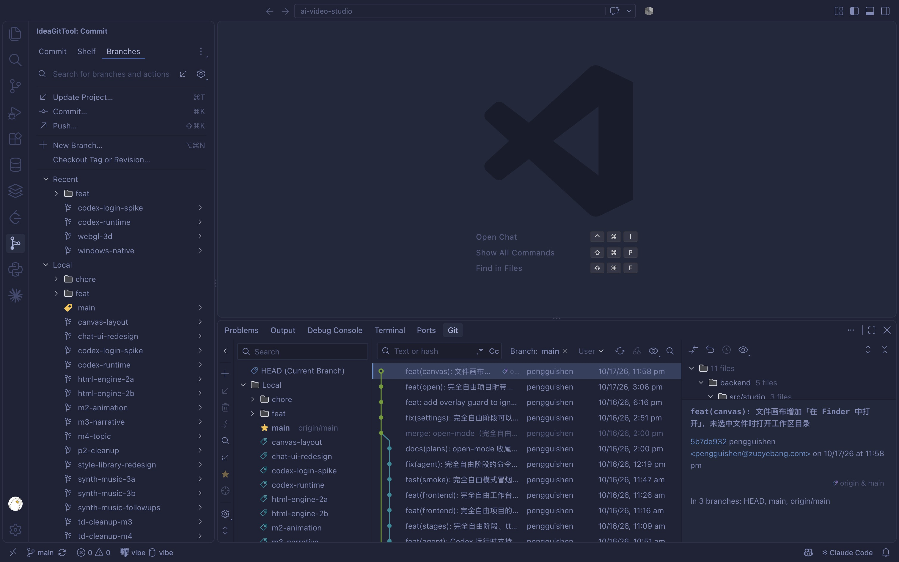

# Git 工作台（dsh-idea-gittool）产品设计 v0.2

| 项目 | 内容 |
|---|---|
| 文档版本 | v0.2（决策已确认，待实现） |
| 日期 | 2026-10-25 |
| 状态 | 设计定稿；首发包含原 P0 + 全部 P1 |
| 产品代号 | Git 工作台 / `dsh-idea-gittool` |
| 参考项目 | [PGshen/vs-idea-gittool](https://github.com/PGshen/vs-idea-gittool)（IdeaGitTool v0.4.2，Apache-2.0） |
| 目标宿主 | DeepSeek Harness Web GUI（右侧栏） |
| 配套调研 | [参考项目功能清单](../references/reference-feature-inventory.md)、[DSH 集成可行性](../references/dsh-integration-feasibility.md)（均已完成） |
| v0.2 决策 | [产品设计决策与变更 v0.2](2026-10-25-产品设计决策-v0.2.md)：独立 bundle、首发含全部 P1、默认日志、编辑器能力结论 |

**评审先读**：§0.1 关键决策 → §6.2 功能范围 → §8.1 日志页 → §16 技术架构 → §19 开放问题。全文较长，细节可按需查阅。

**目录**

- [0. 一句话结论](#0-一句话结论)
- [1. 背景与问题](#1-背景与问题)
- [2. 产品目标与非目标](#2-产品目标与非目标)
- [3. 用户与核心场景](#3-用户与核心场景)
- [4. 设计原则](#4-设计原则)
- [5. 入口与信息架构](#5-入口与信息架构)
- [6. 功能范围与优先级](#6-功能范围与优先级)
- [7. 全局框架与状态](#7-全局框架与状态)
- [8. 页面规格](#8-页面规格)
- [9. Diff 查看器](#9-diff-查看器)
- [10. 冲突解决](#10-冲突解决p0-最小闭环--p1-三栏合并)
- [11. 对话框](#11-对话框)
- [12. Git 控制台](#12-git-控制台)
- [13. 设置](#13-设置)
- [14. 交互细节与快捷键](#14-交互细节与快捷键)
- [15. 视觉规范](#15-视觉规范)
- [16. 技术架构](#16-技术架构方案稿待-spike-验证)
- [17. 里程碑与验收](#17-里程碑与验收)
- [18. 风险与缓解](#18-风险与缓解)
- [19. 开放问题](#19-开放问题需要拍板)
- [20. 附录](#20-附录)

---

## 0. 一句话结论

在 DSH 右侧栏做一个 **IntelliJ 风格的 Git 工作台**：以「日志」为默认页，保留参考项目的提交图、分支面板、提交详情、变更文件与 Diff 的视觉骨架；把参考项目里依赖 VS Code 编辑器的能力（行内 Blame、装饰器、Local History、编辑器 CodeLens）替换为面板内可完成的等价视图；**首发一次性完成**「看历史 → 审改动 → 提交 → 管分支/贮藏 → 冲突解决」的闭环，包含三栏合并与交互式变基。

### 0.1 关键决策（评审重点）

| # | 决策 | 理由 |
|---|---|---|
| D1 | 入口 = 右侧栏引导页卡片 + 命令面板 + 快捷键，不新开顶栏/活动栏；交付为独立 bundle 仓库 | 用户确认入口在右侧栏、独立 bundle；DSH 右侧栏原生支持引导页入口与 tab 类型注册 |
| D2 | 一个 `Git` tab 内含「日志 / 提交 / 分支 / 贮藏」四个内部页；首发一次性包含原 P0 + 全部 P1 | 参考项目把 Log 放底部面板、Commit 放独立工具窗口；右侧栏只有一个面板，必须合并导航；用户要求一步到位 |
| D3 | **默认页固定「日志」**，提交页显示未提交数量徽标 | 用户已确认固定日志；保留参考项目心智，提交入口靠徽标/脏工作区提示 |
| D4 | 宽度自适应：窄屏单列 + 详情抽屉，中屏上下分栏，宽屏/全屏三栏 | 右侧栏默认约为视口 45%，最窄 300px；不能照搬参考项目 1600px 的三栏布局 |
| D5 | 视觉跟 DSH 主题，不套 IntelliJ 皮肤；只保留 IntelliJ 的信息密度、结构和交互习惯 | 套皮会与 DSH 外壳割裂，且要维护两套主题；参考项目本身也提供 `vscode` 外观模式 |
| D6 | 独立 bundle 插件（Host + Client 两半），通过 `dsh plugin --profile web add file:...` 安装 | 不污染 DSH 仓库；Host 用通用 RPC 通道，不依赖 Typert 代码生成 |
| D7 | 不做**真正的**编辑器装饰/行内 blame/CodeLens/Local History；改为「Blame 视图 + 文档预览头部动作 + 文件状态徽标」 | DSH 没有可编辑代码编辑器；公开的 document actions/registry 足以做只读替代；文件树行装饰无 slot |
| D8 | 首发不做多仓库合并日志、子模块、LFS、Clone/Init、Local History、托管平台集成 | 复杂度高、收益低；先保证单仓库主路径 |

**调研回填（2026-10-25，详见两份 research 文档）**

- 独立双面 bundle 可行：一个 `package.json` 同时声明 Host 入口、`./client` 与 `dsh.bundle.patch`，`dsh plugin --profile web add` 安装；无需修改 DSH 仓库。
- 官方 tsdown preset 不能脱离 DSH 仓库，需自写 esbuild 包装；产物契约只有 banner/intro/footer 三行。
- 通信选通用 RPC `/dsh-git`；Typert 生成器要求 DSH 仓库布局，外部包不可用。通用 RPC 一元、JSON、无推送，刷新靠 `workspaceFiles.changes` + 可见时轮询。
- Git 执行走 `ctx.subprocess` + `ctx.sandbox.confine`，不是 `execFile`/`ctx.shell`；cwd 由 Host 从 `sessionId` 解析，不接受客户端传 cwd。
- **沙箱边界是产品约束**：仓库根不在 `workspaceRoot` 内时写操作会被拒绝，因此设计「只读模式 + 写能力门禁」，而不是让整个 tab 报错。

---

## 1. 背景与问题

### 1.1 当前工作流

DSH 的核心工作流是「对话 → Agent 修改工作区文件 → 人审查 → 提交/推送」。目前审查和提交之间是断开的：

1. Agent 改完文件，用户只能看对话里的工具卡片或切到终端执行 `git diff`；
2. 想提交时，要离开 Web GUI，打开终端/VS Code/GitHub Desktop；
3. 想看「这次改动基于哪个提交、和上游差多少、有没有冲突」，缺少一个稳定的上下文视图；
4. 回滚、切分支、贮藏、解决冲突等操作分散在终端和外部工具里，容易误操作。

### 1.2 参考项目提供什么

IdeaGitTool 把 IntelliJ/Rebased 的 Git 客户端完整搬进 VS Code，核心价值是：

- **提交图 + 分支面板 + 提交详情 + 变更文件 + Diff 预览** 的一体化 Log 视图；
- **不经过暂存区、只提交勾选文件** 的 IntelliJ 提交模型；
- **Branches 弹窗**：Update / Commit / Push / New Branch / 所有本地远程分支与标签及其动作；
- **Shelf / Stash / 冲突三栏合并 / 交互式变基 / Worktree / Local History** 等完整工作流；
- 高信息密度、稳定的 IntelliJ 文案、图标、快捷键。

参考项目的体量值得正视：约 128 个源文件 / 28.9k 行、122 条命令、28 种对话框、42 个设置、约 25 个 Log UI 偏好。本设计不追求 1:1 复刻，而是收敛为 **4 个内部页 + 十余个首发对话框 + 10 项设置**，把复杂度花在日志/提交/分支/冲突四条主路径上。

它的限制也很明确：大量能力依附 VS Code 的编辑器、装饰器、保存事件和窗口系统，不能原样搬到 DSH。本设计做的是**能力迁移**，不是像素级复刻。

### 1.3 为什么是右侧栏

- 右侧栏与对话并排，符合「Agent 在左改、我在右审」的协作姿势；
- DSH 右侧栏已有文件、终端、浏览器、文档预览等 tab，Git 是同一类「会话上下文工具」；
- 右侧栏支持拖宽到视口 70%，也支持全屏演示，足以承载 Log 与 Diff；
- 不打断对话主列，不需要新开窗口或切换应用。

---

## 2. 产品目标与非目标

### 2.1 目标

| 目标 | 可衡量结果 |
|---|---|
| G1 让用户在 DSH 内完成 Git 主闭环 | 从打开 Git tab 到完成一次提交 ≤ 3 次点击；不需要切终端 |
| G2 让「Agent 改了什么」一眼可见 | 打开 Git tab 后 1 次点击进入未提交改动；文件级 diff 可读 |
| G3 保留参考项目的 Log 心智 | 提交图、分支面板、提交详情、变更文件四件套齐全；布局可随宽度重排 |
| G4 操作安全、可解释 | 所有破坏性操作二次确认；推送使用 `--force-with-lease`；失败有可行动的错误文案和 Git 控制台 |
| G5 与 DSH 融为一体 | 明暗主题、字体、圆角、菜单、模态、快捷键与 DSH 一致；中英双语 |

### 2.2 非目标（v0.2）

- **不做模型工具**：不注册 `git_*` tool；Agent 继续用 bash 执行 git。避免两套 Git 语义。
- **不做真正的代码编辑器**：不提供文件编辑、编辑器装饰、光标行内 blame、CodeLens、保存历史；改为提供只读「Blame 视图」+ 文档预览头部动作（详见 9.7）。
- **不做 Local History**：DSH 没有统一的编辑器保存事件；用 Git 提交历史 + 文件历史替代。
- **不做多仓库合并日志**：一个会话对应一个工作区，先做单仓库；submodule 后置，Worktree 纳入首发。
- **不做托管平台集成**：不接 GitHub/GitLab API，不做 PR、Issue、Review。
- **不做内置凭据管理**：沿用系统 git credential / SSH agent；认证失败引导到终端。

### 2.3 关键约束（影响产品形态）

| 约束 | 事实 | 产品后果 |
|---|---|---|
| 右侧栏宽度 | 最小 300px、默认约视口 45%、最大 70%，<768px 自动全屏 | 不做常驻三栏；Standard 用上下分栏，Wide 才三栏 |
| 无代码编辑器 | DSH 只有只读文档预览；文件树没有行级装饰 slot，预览有头部动作 slot 与 `documentPreviews` 注册表 | 真正编辑器装饰/行内 blame 不做；做 Blame 视图 + 文档头部动作；文件树状态色需 DSH 新 slot |
| 沙箱边界 | 写 `.git` 需要 `workspace-write` 且仓库根在工作区内 | 仓库根在沙箱外时进入**只读模式**，写操作禁用并说明 |
| 外部插件构建 | 官方 tsdown preset 不能脱离 DSH 仓库 | 自写 esbuild 包装；M0 先验证产物契约 |
| Git 认证 | 无 TTY、`GIT_TERMINAL_PROMPT=0` | 认证失败引导到终端；不在 Web 里收集密码/token |
| 通信 | 通用 RPC 一元、JSON、无推送 | 分页 + 体积上限 + 轮询/`workspaceFiles.changes` 刷新 |

这些约束不是实现细节，而是产品边界：设计中的「全屏」「只读模式」「对话框形态」「刷新策略」都由它们推导。

---

## 3. 用户与核心场景

### 3.1 用户画像

| 画像 | 特征 | 最在意 |
|---|---|---|
| P1 氛围开发者（主） | 用 DSH 生成/修改代码，Git 熟练度中等 | 改了什么、能不能一键提交、别搞坏我的分支 |
| P2 资深工程师 | 熟悉 IntelliJ/命令行，会做 rebase/cherry-pick | 操作是否完整、是否可解释、能否看到真实 git 输出 |
| P3 审阅者 | 不写代码，检查 Agent 产出 | Diff 是否易读、提交信息是否清楚、能否回滚 |

### 3.2 核心用户旅程

**J1 审阅 Agent 的改动并提交（最高频）**

1. 对话结束，右侧栏 Git tab 的「提交」徽标显示 `3`；
2. 点击徽标进入提交页，看到按目录分组的 3 个文件；
3. 点击文件查看 diff，确认无误；
4. 全选/勾选文件，输入提交信息，点「提交」；
5. 状态栏变为「工作区干净」，日志页顶部出现新提交；可选「提交并推送」。

**J2 查看历史、理解当前分支**

1. 打开 Git tab，默认日志页；
2. 提交图显示当前分支与分叉；当前分支高亮，refs 胶囊可见；
3. 点某个提交，底部/右侧显示提交信息、作者、变更文件；
4. 点文件看该提交的 diff；点父提交哈希跳转。

**J3 切换/新建分支**

1. 分支页搜索 `feat/`；
2. 双击签出，或右键「签出」；
3. 工作区有未提交改动时，弹出「智能签出」：贮藏后签出 / 强制签出 / 取消；
4. 状态栏与提交图同步更新。

> 注意：日志页左侧的分支面板单击是「把日志导航到该分支 HEAD」，双击是「过滤日志到该分支」；签出只在 Branches 页或右键菜单里发生。避免浏览历史时误触签出。

**J4 推送 / 拉取 / 更新项目**

1. 仓库栏显示 `↑1 ↓2`；
2. 点「拉取」或「推送」，弹出对话框显示目标远程/分支、将要推送的提交；
3. 推送被拒时，弹出「推送被拒绝」对话框：说明原因（远程有新提交 / 非快进 / 受保护分支），提供「拉取并变基」「拉取并合并」「强制推送（force-with-lease）」「取消」，可勾选「成功后自动重试推送」；
4. 选择拉取方式后，若工作区有改动，走「智能操作」：先贮藏、再合并/变基、成功后恢复；冲突则保留 stash 并打开冲突解决。

**J5 处理合并/变基冲突**

1. 操作停止后顶部出现警告横幅「正在变基 feature → main，2 个冲突」，并自动打开冲突列表（可在设置关闭）；
2. 冲突列表按「未解决 / 已解决」分组；按钮使用具体分支名（`采用 main` / `采用 feat/x`），不写裸 Yours/Theirs；
3. 打开三栏合并窗口，逐块接受或编辑结果；
4. 「接受并完成」后自动继续变基；失败则保留横幅与「继续/跳过/中止」。

**J6 误操作救援**

1. 提交页右键文件「回滚…」丢弃工作区改动；
2. 日志页右键提交「撤销提交…」把改动放回工作区；
3. 所有破坏性操作都有明确的二次确认和影响说明。

---

## 4. 设计原则

1. **对话优先，面板不抢戏**：Git tab 是可随时收起的工具，不改变对话主列布局；默认宽度下也能完成 80% 操作。
2. **读优先，写次之**：先让用户看清楚（日志、diff、状态），再提供操作；操作按钮不压在浏览路径上。
3. **保留 IntelliJ 心智，不照搬像素**：文案、分组、右键菜单、快捷键习惯尽量一致；视觉用 DSH 的设计语言。
4. **一屏之内给出因果**：每个操作前说明「会对什么产生影响」，操作后说明「发生了什么」；不静默 stash、不静默 force。
5. **渐进披露**：窄面板只放高频动作，低频动作进「…」菜单或全屏视图；高级选项放在对话框的「选项」区。
6. **可解释的失败**：错误必须有错误码、人话说明、下一步动作；原始 git 输出只进 Git 控制台，不直接糊在界面上。
7. **可逆优先**：能用 `--force-with-lease` 就不用 `--force`；能提示 stash 就不强切；能软重置就不硬重置。

---

## 5. 入口与信息架构

### 5.1 入口

| 入口 | 位置 | 行为 |
|---|---|---|
| **主入口** | 右侧栏引导页（「开始」页）的入口卡片 | 卡片标题「Git 工作台」，描述「查看提交历史、提交改动与分支操作」，图标为分支/提交图；点击打开或聚焦 Git tab |
| 命令面板 | DSH 命令面板 | `Git: 打开 Git 工作台`；无会话时禁用并说明原因 |
| 快捷键 | 全局命令 | 建议 `Alt+G`（Web/Desktop 待快捷键注册表校验冲突后确定） |
| 状态提示 | Git tab 内状态栏 | 「3 个修改」「2 个贮藏」可点击跳转对应页 |
| 后续入口 | 工具卡片/文件链接的「查看改动」 | P2：从 Agent 产出的文件卡片直接打开对应 diff |

> 入口只注册一次 tab 类型；用户从引导页、命令、快捷键打开的是同一个 tab，重复打开时聚焦已有 tab（DSH `sidebarRight.openTab` 的页类型去重语义）。

### 5.2 顶层信息架构

```
右侧栏 Git tab
├── 仓库栏（Repository bar）
│   ├── 仓库名 / 路径（tooltip）
│   ├── 当前分支 / HEAD 状态 / ahead-behind
│   └── 获取 · 拉取 · 推送 · 刷新 · ⋯（控制台/设置/复制路径）
├── 内部导航（SegmentedTabs）
│   ├── 日志（默认）
│   ├── 提交（徽标：未提交文件数）
│   ├── 分支
│   └── 贮藏（徽标：stash 数）
├── 操作横幅（按需）
│   └── 正在合并/变基/拣选/回滚 + 冲突数 + 继续/中止/解决冲突
├── 内容区（随页面切换）
│   ├── 日志：筛选栏 + 提交图表格 + 分支面板 + 提交详情/变更文件
│   ├── 提交：变更树 + 提交信息 + 提交动作
│   ├── 分支：搜索 + 快捷动作 + 分组列表
│   ├── 贮藏：列表 + 动作 + 预览
│   └── 覆盖层：Diff / 文件历史 / Blame 视图 / 冲突 / 合并窗口（全屏）/ 对话框
└── 状态栏
    ├── 工作区状态 / 分支跟踪 / 操作进度
    └── Git 版本 · 最近刷新时间
```

### 5.3 导航层级

采用「**一个 tab、四个平级页、一个覆盖栈**」，不做多套呈现层混用：

- **Level 0 页面**：日志 / 提交 / 分支 / 贮藏。切换不丢失各页状态（滚动位置、筛选、选中项）。
- **Level 1 覆盖页**：Diff 查看器、文件历史、Blame 视图、冲突列表、交互式变基、Push/Update/Merge/Rebase 等复杂表单。从来源页推入，占据 Git tab 内容区；顶部有「← 返回」；`Esc` 返回上一级；来源页的滚动与选中恢复。
- **Level 2 浮层（sheet / popover）**：简单确认与单字段输入（回滚、删除分支、新建分支、标签、重置、设置）。从边缘或锚点弹出，点击外部/`Esc` 关闭。
- **宿主全屏**：只有**三栏合并窗口**自动使用右侧栏全屏（内容确实需要三栏）。其他页面默认不切宿主全屏；用户仍可用右侧栏自带的「全屏」按钮手动放大当前页。
- **DSH `Modal`**：只用于跨面板的破坏性确认（「丢弃 3 个文件且无法恢复」）或权限/认证提示，不承载常规表单。

**路由规则**

- 同一时刻只有一个覆盖层；打开新的覆盖页时替换当前覆盖页，不叠三层。
- `Esc` 永远只退一级；关闭覆盖页后焦点回到触发控件。
- 返回不会重新请求整页数据；使用已有缓存并保留滚动位置。
- 覆盖页不改变宿主布局；不触发右侧栏宽度变化。

**Tab 标题与提示**

- 标题固定为「Git」，保持稳定，不随分支名变化（分支名在仓库栏显示）。
- 有未提交改动时，标题右侧显示 5px 小圆点（品牌色/警告色），tooltip「3 个未提交文件」；工作区干净时无圆点。
- 有冲突或操作进行中时，圆点变为警告色并在 tooltip 说明「合并进行中 · 2 个冲突」。
- 不在徽标变化时弹 Toast；Agent 修改文件只让徽标/圆点更新，避免打断对话。

不在面板内再套「底部面板」或「活动栏」；参考项目的多窗口结构在右侧栏里压缩为上述层级。

### 5.4 宽度与响应式

DSH 右侧栏：最小 300px，首次打开约为视口 45%，最大约视口 70%，窄视口（<768px）自动全屏。设计分三档：

| 档位 | 面板宽度 | 日志页布局 | 其他页 | 典型场景 |
|---|---|---|---|---|
| **Compact** | 300–599px | 单列：筛选栏（折叠为「筛选」按钮）+ 提交表；分支入口是工具条上的「分支」按钮，打开抽屉；选中提交后全高详情覆盖页 | 单列；提交页变更树在上、信息在下 | 窄窗口、小屏 |
| **Standard** | 600–999px | 上下分栏：提交表在上，详情/变更文件在下（默认 38% 高，可拖拽）；分支入口是工具条按钮/抽屉 | 单列 + 可拖拽分栏 | 默认打开（视口约 1440–1920） |
| **Wide** | ≥1000px 或用户手动全屏 | 三栏：分支面板（200–240px）｜提交表（flex）｜详情（320–380px） | 双栏（列表 + 详情） | 用户拖宽、全屏审阅 |

补充规则：

- **不常驻 24px 竖条**：分支面板在 Standard/Compact 下默认隐藏，通过工具条的「分支」按钮打开抽屉或覆盖页；关闭抽屉不改变表格宽度。Wide 档可常驻左栏（用户可折叠）。
- 详情在 Compact 下为全高覆盖页；在 Standard 下为底部可拖拽面板；在 Wide 下为右侧栏。
- 只有三栏合并窗口自动进入宿主全屏；并排 Diff、交互式变基、复杂表单使用 Git tab 内的全宽/全高覆盖页，不切宿主全屏。
- 面板变窄时按顺序隐藏：作者列 → 日期列 → 哈希列 → refs 只留当前分支 → 提交图宽度封顶；**主题、分支按钮、提交按钮、搜索永不隐藏**。
- 提交图宽度不按百分比无限增长：最大 160px（约 10 lane），超过后只显示前 10 lane + 「+n」提示；保证 subject 至少 220px。
- 记住用户拖拽的宽度、分栏比例、分支栏显隐（按会话持久化）。

---

## 6. 功能范围与优先级

### 6.1 分级定义

- **P0（实现第 1 批）**：没有它就不能完成「看 → 审 → 提交 → 分支/贮藏」主闭环。
- **P1（实现第 2 批，首发包含）**：高频进阶操作；**与 P0 一起在 `1.0.0` 发布**，不再单独延后。
- **P2（首发不做）**：低频/高复杂度/依赖外部能力。
- **不做**：与 DSH 形态冲突或收益过低。

> **v0.2 范围决策**：应用户要求，首发一次性包含原 P0 + 全部 P1，只发一个 `1.0.0`；P0/P1 现在只表示实现顺序。P2 仍不做。内部按阶段实现、验收和 feature flag 控制风险，详见 [决策记录 v0.2](2026-10-25-产品设计决策-v0.2.md)。
>
> 本设计的目标是**形态迁移**，不是功能减法。参考项目的 Git 能力尽量保留；真正被去掉的只有强依赖 VS Code 编辑器的能力（真正的装饰器、光标行内 blame、CodeLens、Local History），并用「Blame 视图 + 文档预览头部动作」替代。

### 6.2 功能矩阵

| 模块 | 能力 | 参考项目对应 | 优先级 | 说明 |
|---|---|---|---|---|
| 全局 | 仓库识别、分支/HEAD 状态、ahead/behind、工作区脏状态 | Log/Commit 头部 | P0 | `git status --porcelain=v2 --branch` |
| 全局 | 自动/手动刷新、操作进行中横幅 | 各视图 | P0 | 轮询 + `.git` watch |
| 全局 | Git 控制台（命令、耗时、退出码、复制） | Git Console | P0 | 信任与排障的关键 |
| 日志 | 提交图（lane、颜色、refs、当前分支高亮、懒加载） | Log | P0 | 增量 lane 布局，虚拟滚动 |
| 日志 | 文本/哈希搜索（正则、大小写）、分支/用户过滤 | Filter bar | P0 | 日期/路径过滤 P1 |
| 日志 | 图选项（日期/拓扑、第一父、无合并） | Graph Options | P0 | 折叠线性分支 P1 |
| 日志 | 跳转到哈希/分支/标签 | Go to | P0 | |
| 日志 | 分支面板（HEAD/本地/远程/标签、收藏、按目录分组、右键菜单） | Branches pane | P0 | 收藏/分组 P1 |
| 日志 | 提交详情（作者/提交者/父提交/refs/所在分支） | Details | P0 | 「In N branches」P1 |
| 日志 | 变更文件树 + 文件级 diff 预览 | Changes + Diff | P0 | 首发包含统一 + 并排 diff |
| 日志 | 提交右键菜单（复制哈希、签出、新建分支、拣选、回滚、重置、比较、创建补丁） | Commit menu | P0/P1 | 前半 P0；fixup/squash/drop/交互式变基 P1 |
| 日志 | 文件历史 / Blame 视图 / 与版本比较 | File History / Annotate | P1 | 面板内只读视图；不做光标行内 blame |
| 日志 | 文档预览头部 Git 动作：状态徽标 + Blame/历史/Diff | 编辑器 Tab 装饰（替代） | P1 | 公开 slot `sidebar.right.tab.document.actions`；不是文件树装饰 |
| 日志 | 长边折叠、GPG 签名列、未 cherry-pick、只看我的分支 | View Options | P2 | |
| 日志 | 多仓库合并日志、Drop/Extract 部分改动、Add Commits to Remote | 多仓库 | P2 | |
| 提交 | 变更树（已修改/新增/删除/重命名/冲突/未跟踪）、复选、目录分组、搜索 | Commit | P0 | Changelist P1 |
| 提交 | 只提交勾选文件、不污染暂存区 | IntelliJ 模型 | P0 | `git commit --only` + 未跟踪文件 `add -N`；**merge/cherry-pick 状态例外**，见 8.2.4 |
| 提交 | 操作状态提交：合并提交、继续拣选/回滚 | Merge/Pick | P0 | 冲突全部解决后提交整个索引，不能用 `--only` |
| 提交 | 提交信息（多行、历史、Amend HEAD / 仅改信息） | Commit | P0 | Amend 更早提交 P1；无文件时允许仅改信息 |
| 提交 | 提交 / 提交并推送 / 推送对话框 | Commit and Push | P0 | |
| 提交 | 推送被拒处理：拉取并变基 / 拉取并合并 / force-with-lease / 自动重试 | Push Rejected | P0 | 非快进与受保护分支是最常见失败 |
| 提交 | 智能操作：脏工作区下 merge/rebase/cherry-pick 先 stash、后恢复 | Smart Merge/Checkout | P1 | 失败冲突时保留 stash 并提示 |
| 提交 | 作者、Sign-off、跳过 hooks、GPG 签名 | Commit options | P1 | 默认跑 hooks |
| 提交 | 回滚、加入 VCS、加入 .gitignore、提交单个文件、创建补丁 | Rollback / Add | P0/P1 | 回滚/单文件提交 P0；.gitignore/补丁 P1 |
| 提交 | 上游强推后的恢复：备份分支 + 重置 + 恢复入口 | Reset to Remote | P1 | 先建 `backup/<branch>-<ts>`，避免丢提交 |
| 提交 | Changelist、拖放、Shelve/Unshelve | Shelf | P1 | 贮藏页内的 Shelf 分段 |
| 提交 | 冲突最小闭环：冲突文件列表、按具体分支采用左/右侧、标记已解决、继续/中止 | Conflicts | P0 | 按钮显示具体分支名，不写裸 Yours/Theirs；不要求三栏合并 |
| 提交 | 三栏可编辑合并窗口、全部简单冲突、逐块 Accept、Review Changes | Merge window | P1 | 成本最高的单项；先用「冲突列表 + 接受 + 终端兜底」 |
| 分支 | 本地/远程/标签、当前分支、ahead/behind、收藏、按目录分组、搜索 | Branches | P0 | 收藏 P1 |
| 分支 | 快捷动作：更新项目、提交、推送、继续/中止、新建分支、签出标签/版本 | Branch actions | P0 | |
| 分支 | 签出、智能签出、新建/重命名/删除、合并、变基、拉取、推送、比较、设上游 | Branch menu | P0/P1 | 核心 P0；比较/设上游 P1 |
| 分支 | 标签操作：签出标签、从标签建分支、合并标签、推送标签、删除标签、比较 | Tag menu | P0/P1 | 签出/建分支 P0；其余 P1 |
| 分支 | 对话框：Push / Push Rejected / Update / Pull / Fetch / Merge / Rebase / Reset / New Branch / Tag | Dialogs | P0/P1 | Push/Rejected/Update/New Branch/Tag/Reset P0；Remotes/Clone P1 |
| 分支 | 交互式变基 | Interactive Rebase | P1 | 面板内全高列表 + 动作选择 |
| 分支 | Worktree 列表/新建/删除 | Worktrees | P1 | 首发包含；用 feature flag 控制 |
| 分支 | 多仓库同步分支控制 | Multi-repo | P2 | |
| 贮藏 | 列表、创建、应用、弹出、删除、预览 | Stash | P0 | 创建选项：含未跟踪、保留索引 |
| 贮藏 | Shelf（命名补丁） | Shelf | P1 | 与 Stash 并列分段 |
| Diff | 统一 diff、行号、+/- 着色、按文件切换 | Diff preview | P0 | 复用 `--dsw-alias-file-diff-*` |
| Diff | 并排 diff、词级高亮、忽略空白、折叠未改片段 | Diff preview | P1 | 宽屏或用户手动全屏时使用 |
| Diff | 提交 vs 工作区、两提交比较、分支比较 | Compare | P1 | |
| 冲突 | 三栏可编辑合并、全部简单冲突、逐块 Accept（P0 已有列表与整文件接受） | Merge window | P1 | 需要 CodeMirror 6 或自研合并编辑器 |
| 其他 | 文件历史、Blame 视图、创建/应用补丁、Worktree | 各类 | P1 | 首发包含 |
| 其他 | 真正的行内 Blame、编辑器装饰、CodeLens、Local History | VS Code 专属 | 不做 | 无编辑器；用 Blame 视图/文档头部动作替代 |
| 其他 | 托管平台 PR/Issue、凭据管理、LFS、子模块 | — | 不做 | 明确边界 |

### 6.3 与参考项目的 UI 映射

| 参考项目 | DSH 中的形态 | 调整原因 |
|---|---|---|
| 底部 **Git** 面板中的 Log | 右侧栏「日志」页 | 右侧栏只有一个内容区，底部面板会挤压对话 |
| 活动栏 **Commit** 工具窗口（Commit/Shelf/Stash/Branches 四个 tab） | 「提交 / 贮藏 / 分支」三个内部页 | 合并导航；Shelf 并入贮藏 |
| 编辑器 tab 中的对话框 | DSH `Modal` | 右侧栏没有编辑器 tab 体系 |
| VS Code diff 编辑器 | 面板内 **Diff 查看器**（可全屏） | 不依赖编辑器 |
| VS Code 合并编辑器 | 全屏 **三栏合并窗口** | 保留 IntelliJ 的操作骨架 |
| 资源管理器/编辑器标签页的 Git 状态色 | 不做；改为提交页与日志页的状态字母/颜色 | 无文件树装饰能力 |
| 状态栏分支 widget | 仓库栏分支胶囊 + 面板状态栏 | 面板内自洽 |
| 命令面板 / VCS Operations Popup | 命令面板命令 + 面板内「…」菜单 | 复用 DSH 命令体系 |
| 设置编辑器 | 面板内设置弹层；P1 接 DSH 设置页 | 不新增全局配置负担 |

---

## 7. 全局框架与状态

### 7.1 框架线框（Standard 宽度）

```
┌──────────────────────────────────────────────────────────────────────┐
│  Git 工作台                                                          │
│  ▦ dsh-idea-gittool        ⎇ main  ↑1 ↓2        [获取] [拉取] [推送] [⋯] │  ← 仓库栏 36px
├──────────────────────────────────────────────────────────────────────┤
│  日志      提交 3      分支      贮藏 2                                │  ← 内部导航 36px
├──────────────────────────────────────────────────────────────────────┤
│  ⚠ 正在变基 feature → main · 2 个冲突      [解决冲突…] [继续] [中止]   │  ← 操作横幅（按需）
├──────────────────────────────────────────────────────────────────────┤
│  🔍 文本或哈希  .* Aa   [分支 ▾] [用户 ▾] [日期 ▾]    [图选项 ▾] [视图 ▾] │  ← 筛选栏 34px
├──────────────────────────────────────────────────────────────────────┤
│  ●─┐ feat: 完成 Git 日志页                          [main] [origin/main] │
│  │ ● fix: 修正窄屏下的详情抽屉                       Alice  10-24 18:12  │
│  │ ●─┐ merge: 合入分支保护                            Bob    10-24 17:40  │
│  │ │ ● docs: 补充设计说明                             Chen   10-24 16:02  │
│  ...                                                                   │
├──────────────────────────────────────────────────────────────────────┤
│  feat(scope): 完成 Git 日志页                        7f3a2c1  [复制]    │  ← 详情面板（可拖拽）
│  Alice <alice@example.com> · 2026-10-24 18:12 · 父提交 1a2b3c4         │
│  ─────────────────────────────────────────────────────────────────    │
│  变更文件 (5)                                              +128 −32    │
│  ▾ src/                                                               │
│    M  log/LogTable.tsx       M  log/Graph.tsx                         │
│    A  log/FilterBar.tsx                                               │
└──────────────────────────────────────────────────────────────────────┘
│  ⎇ main ↑1 ↓2 · 3 个修改 · 2 个贮藏 · Git 2.45.1 · 12:03 刷新           │  ← 状态栏 24px
└──────────────────────────────────────────────────────────────────────┘
```

> 上图是 Standard 档的上下分栏；Wide 档把详情移到右侧，分支面板从工具条「分支」按钮打开 200–240px 固定栏。实际实现中仓库栏与状态栏更紧凑，视觉上不要出现「卡片套卡片」。

### 7.2 空状态 / 异常状态

| 状态 | 展示 | 主行动 |
|---|---|---|
| 未选择会话 | 居中图标 + 「请先选择一个会话」 | 无（命令禁用并说明） |
| 会话没有工作区目录 | 「这个会话没有工作区目录」 | 「查看工作区设置」（跳转 DSH 设置） |
| 工作区不是 Git 仓库 | 分支图标 + 「当前工作区不是 Git 仓库」+ 当前路径 | 「初始化仓库…」（P2，风险确认）/「查看帮助」 |
| 只读模式（仓库根在沙箱外） | 顶部横幅「当前会话目录不是仓库根，写操作受沙箱限制」+ 解锁说明 | 「如何打开仓库根」/「仍然浏览历史」（只读） |
| 空仓库（无提交） | 「还没有提交」+ 当前分支名 | 「创建首次提交」（跳提交页） |
| 找不到 git | 「未找到 git 命令」+ 安装说明 | 「重新检测」/「设置 git 路径」（P1） |
| 需要认证 | 「Git 需要认证」+ 远程地址（脱敏） | 「复制命令到终端」/「重试」 |
| 操作进行中 | 顶部横幅 + 冲突数 + 继续/中止 | 「解决冲突…」 |
| 读取失败 | 错误码 + 人话说明 + 「重试」 | 「打开 Git 控制台」 |
| 加载中 | 骨架行（保持行高，不跳动） | 无 |

### 7.3 操作横幅

- 触发：仓库处于 `MERGE_HEAD` / `rebase-merge` / `rebase-apply` / `CHERRY_PICK_HEAD` / `REVERT_HEAD` / `BISECT_LOG` 状态。
- 内容：操作类型（合并/变基/拣选/回滚/二分）、源分支（能解析时）、目标分支、冲突文件数、进度（变基 `2/5`）。
- 动作：`解决冲突…`（有冲突时）、`继续`、`跳过`（仅变基，逐提交跳过）、`中止…`（危险色）、`查看控制台`。
- 合并/变基完成后自动消失；失败保留并说明原因。

### 7.4 状态栏

固定一行 24px，信息按优先级从左到右：

1. 当前分支 / detached HEAD（危险色）；
2. ahead/behind（↑n ↓n）；
3. 工作区摘要：「3 个修改」「无改动」「2 个冲突」；
4. 贮藏数（可点击）；
5. 操作进度（如「变基 2/5」）；
6. 右侧：Git 版本、最近刷新时间、自动刷新开关（图标）。

---

## 8. 页面规格

### 8.1 日志页（核心）

#### 8.1.1 布局

**Wide（≥1000px 或全屏）**

```
┌───────────────┬────────────────────────────────────────────┬──────────────────────────┐
│ 分支           │ 提交图 / 提交列表                           │ 提交详情                  │
│               │                                            │                          │
│ HEAD (main)   │ ●─┐ feat: 完成 Git 日志页    [main][origin] │ feat: 完成 Git 日志页      │
│ ▾ Local       │ │ ● fix: 修正窄屏下的详情抽屉               │ 7f3a2c1  [复制]           │
│   ★ main      │ │ ●─┐ merge: 合入分支保护                   │ Alice · 10-24 18:12       │
│     feat/log  │ │ │ ● docs: 补充设计说明                    │ 父提交 1a2b3c4            │
│   ▸ chore     │ │ │ ● test: 补日志页用例                    │ ──────────────────────    │
│ ▸ Remote      │ │ │ ● ...                                   │ 变更文件 (5)     +128 −32 │
│ ▸ Tags        │ │ │                                         │ ▾ src/                    │
│               │ │ │                                         │   M LogTable.tsx          │
│ [收起]        │ │ │                                         │   A FilterBar.tsx         │
└───────────────┴────────────────────────────────────────────┴──────────────────────────┘
```

**Standard（600–999px）**

```
┌──────────────────────────────────────────────────────────────┐
│ ▸ 分支   🔍 文本或哈希  .* Aa  [分支 ▾] [用户 ▾]  [筛选 ▾]    │
├──────────────────────────────────────────────────────────────┤
│ ●─┐ feat: 完成 Git 日志页                     [main] [origin] │
│ │ ● fix: 修正窄屏下的详情抽屉                 Alice 10-24 18:12│
│ │ ●─┐ merge: 合入分支保护                     Bob   10-24 17:40│
│ ...                                                          │
├──────────────────────────────────────────────────────────────┤  ← 可拖拽分隔线
│ 提交详情：feat(scope): 完成 Git 日志页            7f3a2c1     │
│ Alice · 10-24 18:12 · 父提交 1a2b3c4                          │
│ 变更文件 (5)  ▾ src/  M LogTable.tsx  A FilterBar.tsx         │
└──────────────────────────────────────────────────────────────┘
```

**Compact（300–599px）**

```
┌──────────────────────────────────────────┐
│ ▸ 分支   🔍 搜索…              [筛选 ▾]  │
├──────────────────────────────────────────┤
│ ● feat: 完成 Git 日志页        [main]     │
│ ● fix: 修正窄屏下的详情抽屉    Alice      │
│ ● merge: 合入分支保护          Bob        │
│ ...                                      │
└──────────────────────────────────────────┘
   点击某行 → 全高详情覆盖层（← 返回）

┌──────────────────────────────────────────┐
│ ← 返回   7f3a2c1  [复制]                  │
│ feat(scope): 完成 Git 日志页              │
│ Alice · 10-24 18:12                       │
│ 变更文件 (5)                              │
│   M src/log/LogTable.tsx                  │
│   A src/log/FilterBar.tsx                 │
└──────────────────────────────────────────┘
```

**参考布局（IdeaGitTool 原版，来自项目 README）**



> 参考图是约 1600px 宽的三栏布局：左 Branches、中提交图表格、右提交详情与变更文件。我们的 Wide 档保留这个骨架；Standard/Compact 档按 8.1.1 重排，不强行压成三栏。原图版权归 IdeaGitTool 作者，Apache-2.0，仅作设计参考。

#### 8.1.2 筛选栏

**脏工作区提示条（P0）**

当工作区有未提交改动时，在筛选栏上方显示一行 28px 提示条：

```
● 3 个未提交改动 · 2 个冲突        [去提交]  [稍后]
```

- 「去提交」切到提交页；「稍后」仅隐藏本次，下次打开/刷新仍显示。
- 有冲突时提示条用警告色，文案变为「2 个冲突待解决 [解决冲突…]」。
- 工作区干净时不占空间。

**筛选控件**（从左到右）：

1. **搜索框**：占位「文本或哈希」；支持提交信息、作者、哈希；`Enter` 立即应用，输入 600ms 防抖；`Esc` 清空并回到表格；内嵌 `.*`（正则）与 `Aa`（区分大小写）切换按钮。
2. **分支筛选**：菜单多选；分组 = HEAD / 收藏 / 最近 / 本地 / 远程 / 标签；选中后显示为 `分支: main ×` 胶囊。
3. **用户筛选**：菜单多选，按提交作者聚合；显示 `用户: Alice ×`。
4. **日期筛选**（P1）：预设（今天/近 7 天/近 30 天/自定义区间）。
5. **路径筛选**（P1）：选择文件/目录；显示为路径胶囊。
6. **图选项**：按提交日期 / 拓扑排序；仅第一父提交；不显示合并提交；折叠线性分支（P1）；显示长边（P1）。
7. **视图选项**：列显示（作者/日期/哈希/签名）；高亮当前分支；仅显示我的分支（P1）；未被 cherry-pick 的提交（P2）。
8. **跳转**：输入哈希/分支/标签，`Enter` 定位；找不到时输入框红框 + 错误提示。
9. **刷新**：手动刷新按钮；有后台更新时显示小圆点。

窄屏：搜索框占满第一行，其余收进「筛选」按钮的菜单/弹层；已生效的筛选以横向可滚动的胶囊行显示。

#### 8.1.3 提交图表格

| 元素 | 规格 |
|---|---|
| 行高 | 26px（与参考项目一致）；紧凑模式 24px（P1） |
| 列 | 图（按 lane 计算，14px/lane，**最大 160px**）｜主题 + refs（flex，最小 220px）｜作者（110px，<720px 隐藏）｜日期（96px，<720px 隐藏）｜哈希（72px，可选）｜签名（20px，P1） |
| 提交节点 | 圆点 7.2px 直径；HEAD 节点空心环；当前分支节点加外环 |
| 边 | 1.6px 圆头线；lane 间斜线/曲线；父子边颜色取子提交 lane 色；跨页/未加载父提交用虚线 |
| 颜色 | 6 个主题静态色系与 `label-primary` 做 `color-mix`，按 lane 分配；第 7 条起复用色相 + 线型；保证与背景 ≥3:1（见 15.3） |
| refs 胶囊 | 本地分支（绿）/ 远程分支（蓝）/ 标签（琥珀）/ HEAD（品牌色）；最多显示 3 个，超出 `+n` 悬浮展开 |
| 当前分支 | 行背景极淡品牌色（或左侧 2px 品牌色条），只在日志包含非当前分支提交时启用 |
| 选中 | 单行选中用交互背景；多选（Shift/Ctrl）用 multi-select 背景；键盘焦点环清晰可见 |
| 悬停 | 行背景 hover；显示「查看详情」提示；长边箭头可点击跳父/子提交 |
| 空行 | 加载下一页时保留骨架行；不显示整页 spinner |

**交互**

- 单击：选中并加载详情；双击/Enter：打开该提交的 diff（默认第一个变更文件或合并 diff）。
- `↑/↓` 移动，`Shift+↑/↓` 扩展多选，`PgUp/PgDn` 翻页，`Home/End` 首尾。
- `←/→`：跳到子/父提交（参考项目的长边箭头心智）。
- 右键：提交菜单（见 8.1.7）。
- 滚动接近底部时自动加载下一页（每页 100 条，最多保留 2000 行；超出提示「继续加载」）。
- 滚动时保持选中行可见；切换筛选后回到顶部并保留筛选条件。

**Graph 算法要点**

- 客户端维护一个增量 `GraphLayout`：按拓扑或日期顺序喂入 `(hash, parents[])`，维护 lane → 等待中的父提交哈希、lane 颜色、边段；每行输出 `{ lane, color, edges[], width }`。服务端只返回提交行（hash/parents/元数据），不做图形布局。
- 翻页时保留布局状态，追加行而不是重算；筛选/排序变化时重建。
- 颜色用稳定的 `colorId` 分配，不随滚动变化；lane 压缩后颜色跟随边段移动。
- 父提交不在当前结果集（被过滤）时画虚线；已知但未加载时画实线短 stub。

#### 8.1.4 分支面板

- 结构：`HEAD`（当前分支，含 detached 说明）→ `Local` → `Remote`（按 remote 分组）→ `Tags`。
- 每行：类型图标（本地/远程/标签/HEAD）、名称、收藏星标、upstream、`↑n ↓n`、当前分支加粗/勾选。
- 支持按目录分组（`feat/login` 显示为 `feat ▸ login`），默认开启；扁平模式可切换。
- 搜索框过滤名称；无结果时显示「没有匹配的分支」。
- **单击**：把日志导航到该分支 HEAD（不改变分支筛选）；**双击**：把日志过滤到该分支（参考项目行为）。签出不在这里发生。
- **右键**：完整分支菜单（见 8.3.4），「签出」是显式菜单项。
- 呈现：Wide 档可常驻左栏并可折叠；Standard/Compact 档默认隐藏，通过工具条「分支」按钮打开抽屉/覆盖页，点击外部关闭。**不使用常驻 24px 竖条**，避免遮挡表格和误触。
- 收藏（P1）：星标固定在「收藏」组；按会话持久化。
- 顶部 26px 工具条（Wide 档）：新建分支、更新所选、删除、与当前比较、获取、收藏、定位 HEAD、展开/折叠全部、设置；窄档收进「⋯」，不挤占树宽度。
- 多选时提供「比较分支」「查看差异文件」「更新所选」「删除」（P1）。

#### 8.1.5 提交详情

按顺序：

1. **主题**（15px/600，可换行，最多 3 行，悬浮显示全文）；
2. **哈希**（12px mono）+ 复制按钮；短哈希 7–8 位；
3. **refs**：当前提交指向的分支/标签胶囊；
4. **作者行**：`Alice <alice@example.com>` · 绝对时间（悬浮显示相对时间）；
5. **提交者**：与作者不同时显示 `提交者 Bob`；
6. **父提交**：`父提交 1a2b3c4`（可点击跳转；合并提交显示多个）；
7. **GPG**（P1）：已验证/未知/过期徽标 + tooltip；
8. **提交信息正文**：保留换行，等宽/正文字体按 DSH；超长折叠「展开全部」；
9. **所在分支**（P1）：「在 3 个分支中」+「查看全部」弹层；
10. **变更文件**：文件树 + 状态字母 + 增删行数；点击文件打开 Diff；右键复制路径/文件历史/Blame（P1）。

**变更文件树**

- 分组：按目录（默认）/ 扁平；根节点显示文件数。
- 行：状态字母（M/A/D/R/C/T/U）、文件名、目录（扁平模式）、`+n −n`。
- 状态色：修改（蓝/琥珀）、新增（绿）、删除（红）、重命名（紫）、冲突（红底/警告）、未跟踪（灰）。
- 多选文件可「复制路径」「与工作区比较」（P1）。
- 合并提交：按父提交分组「对父提交 1a2b3c4 的变更」，可折叠。

#### 8.1.6 Diff 预览入口

- 单击变更文件 → 打开 **Diff 查看器**（覆盖层），返回后保留提交与文件选中。
- 双击提交 → 打开该提交第一个文件的 diff；若没有变更文件，显示提交信息。
- 合并提交默认显示「合并差异」或选择某个父提交比较（P1）。

#### 8.1.7 提交右键菜单

**P0**

- 复制修订号（完整哈希）
- 复制短哈希
- 签出此提交（detached HEAD，危险提示）
- 从此提交新建分支…
- 拣选此提交…（cherry-pick）
- 回滚此提交…（revert，生成反向提交）
- 将当前分支重置到此提交…（soft/mixed/hard）
- 与此提交比较（P1）
- 创建补丁…（P1）
- 在日志中跳转到父/子提交
- 复制提交信息

**P1**

- 修改提交信息…（reword）
- 撤销提交…（reset --soft HEAD~1，保留改动）
- Fixup / Squash into…
- 丢弃提交…（drop，需交互式变基）
- 压缩提交…（squash commits）
- 从此处交互式变基…
- 推送直到此提交…
- 新建标签…

菜单规则：危险项用危险色 + 二次确认；不可用项禁用并给 tooltip 原因（如「当前有未提交改动」）；分隔线按语义分组（复制 / 导航 / 修改 / 危险）。

### 8.2 提交页

#### 8.2.1 布局

```
┌──────────────────────────────────────────────────────────────────┐
│  变更 (3)      [全选]  [按目录 ▾]  [🔍 搜索文件]                  │
├──────────────────────────────────────────────────────────────────┤
│  ▾ src/ (2)                                                      │
│    ☑ M  log/LogTable.tsx                         +128 −32        │
│    ☐ M  log/Graph.tsx                            +12  −4         │
│  ▾ 未版本控制 (1)                                                 │
│    ☑ ?  scratch.md                                               │
├──────────────────────────────────────────────────────────────────┤
│  提交信息                                      [历史 ▾]           │
│  ┌────────────────────────────────────────────────────────────┐  │
│  │ feat(log): 完成 Git 日志页                                 │  │
│  │                                                            │  │
│  └────────────────────────────────────────────────────────────┘  │
│  ☐ Amend  [作者 ▾] [签名 ▾]                    [提交] [提交并推送 ▾] │
└──────────────────────────────────────────────────────────────────┘
```

#### 8.2.2 变更树

- 分组顺序：冲突（最高）→ 已修改 → 新增 → 删除 → 重命名 → 未版本控制。P1 支持 Changelist 分组。
- 目录节点三态复选：全选/半选/未选；点击目录切换其下所有文件。
- 行：复选框、状态字母、文件图标、路径（`PathLabel`）、增删行数（未跟踪文件不显示行数，或异步统计）。
- 搜索：按路径过滤；不改变勾选状态。
- 排序：目录优先，文件按自然序；可切换「按修改时间」（P1）。
- 双击/Enter：打开工作区 diff。
- 右键菜单：**提交此文件…**（只勾选该文件并聚焦提交信息）、**回滚此文件…**、加入 VCS、加入 .gitignore（P1）、创建补丁…（P1）、复制路径、在文件管理器中显示（P2）。
- 冲突文件：红色状态 + 「解决冲突…」入口 + 「采用左侧 / 右侧」快捷项（显示具体分支名）；未解决前禁止提交。

#### 8.2.3 提交信息

- 多行输入，默认 3 行高，随内容增长到 8 行后滚动；等宽/正文按 DSH。
- 第一行作为 subject；空行后为 body；不强制模板。
- 历史：最近 20 条提交信息，下拉选择；选择后光标置于末尾。
- `Cmd/Ctrl+Enter` 提交；提交中按钮 loading 且禁止重复点击。
- 长度提示：subject > 72 字符时显示柔和提示（不阻塞）。
- 记住草稿：按会话保存未提交的提交信息（localStorage，关闭/切换 tab 不丢）。

#### 8.2.4 提交动作

**普通提交（无进行中的合并/变基/拣选/回滚）**

- **提交**：只提交勾选文件，不使用暂存区语义。
  - 已跟踪文件：`git commit --only -m <msg> -- <paths>`；
  - 未跟踪文件：先 `git add -N -- <paths>`（intent-to-add），再 `commit --only`；
  - 删除/重命名：`--only` 覆盖；重命名通过 `-M` 识别。
  - 若用户没有勾选任何文件：按钮禁用，提示「请至少选择一个文件」。
- **仅修改提交信息（Amend，无文件勾选）**：允许。要求索引相对 HEAD 没有额外暂存改动；执行 `git commit --amend -m <msg>`，不改文件内容。若检测到暂存区有未勾选的改动，提示先处理，避免把无关改动带进 amend。
- **提交并推送 ▾**：默认推送到当前分支 upstream；无 upstream 时打开 Push 对话框选择远程/分支并设置 upstream。
- **Amend**：修改 HEAD；若 HEAD 已推送，显示「这会改写已推送的历史」警告；更早提交的 amend 由首发内的交互式变基支持。
- **作者/签名**：弹出小面板，填写 Name/Email、Sign-off、GPG 签名；默认值来自 `git config user.*`；按仓库记忆。
- **提交成功后**：清空草稿与勾选，刷新状态与日志，Toast「已提交 7f3a2c1」；若还有改动，保留提交页。
- **hooks 失败**：不吞输出；显示「提交被 Git hook 阻止」+ 失败摘要 + 「查看 Git 控制台」；不自动 `--no-verify`。
- **空提交**：不提供（避免噪音）；P2 可加「允许空提交」。

**操作状态提交（合并 / 拣选 / 回滚 / 变基）**

`git commit --only` 在 merge/cherry-pick 状态下会失败（Git 不允许带 pathspec 的 `--only` 提交合并结果），因此提交页必须切换模式：

| 状态 | 提交页形态 | 动作 |
|---|---|---|
| **合并中**（`MERGE_HEAD`） | 文件复选框禁用（全部视为已解决/已暂存）；顶部显示「合并提交」；提交信息预填 `.git/MERGE_MSG`，可编辑 | `提交合并` → `git commit -m <msg>`（不带 pathspec）；冲突未清零时禁用 |
| **拣选中**（`CHERRY_PICK_HEAD`） | 只显示本次拣选的变更；复选框禁用 | `继续拣选` → `git add` 已解决文件后 `git cherry-pick --continue`；`跳过`/`中止` 在横幅 |
| **回滚提交中**（`REVERT_HEAD`） | 同上 | `继续回滚` → `git revert --continue` |
| **变基中** | 提交页不承担提交；冲突解决后由横幅「继续变基」 | `git rebase --continue`；提交信息编辑 P1 |

- 操作状态下，如果还有未解决冲突，提交按钮禁用并提示「还有 N 个冲突未解决」。
- 操作状态下的提交不再提供「只提交勾选文件」；用户在操作开始前应已决定范围。
- 操作完成后回到日志页并高亮新的 HEAD；失败保留横幅与错误摘要。

#### 8.2.5 回滚与忽略

- **回滚…**：丢弃所选文件的工作区改动（`git restore --worktree -- <paths>`；未跟踪文件需删除，使用危险确认）。
- **加入 VCS**：`git add -N`（保持 IntelliJ 的「加入版本控制」语义）或 `git add`（可配置）。
- **加入 .gitignore…**（P1）：为所选文件生成模式，追加到仓库根 `.gitignore`，预览后写入。
- **复制路径**、**在文件管理器中显示**（P2，接 DSH open-in-app）。

### 8.3 分支页

#### 8.3.1 布局

```
┌──────────────────────────────────────────────────────────────────┐
│  🔍 搜索分支和操作                              [获取]  [设置 ▾]   │
├──────────────────────────────────────────────────────────────────┤
│  ⟳ 更新项目…                                            ⌥T       │
│  ✓ 提交…                                                ⌥K       │
│  ↑ 推送…                                                ⇧⌥K      │
│  ⏸ 继续 / 中止（仅操作进行中）                                    │
│  + 新建分支…                                            ⌥N       │
│  ⤓ 签出标签或版本…                                               │
├──────────────────────────────────────────────────────────────────┤
│  ▾ 最近                                                           │
│    feat/login                                                     │
│  ▾ 本地                                                           │
│    ★ main            origin/main    ↑1 ↓2    ›                    │
│      feat/log                                                     │
│  ▸ 远程                                                           │
│  ▸ 标签                                                           │
└──────────────────────────────────────────────────────────────────┘
```

#### 8.3.2 结构

- 顶部动作区固定：更新项目、提交、推送、继续/中止（按需）、新建分支、签出标签或版本。
- 分组：最近（P1）/ 本地 / 远程 / 标签；可折叠；按目录分组可切换。
- 当前分支置顶并加粗；upstream 以次要文字显示；ahead/behind 用 `↑n ↓n`。
- 收藏（P1）：星标固定在顶部「收藏」组。
- 搜索同时匹配分支名和动作名（参考项目行为）；无结果时显示「没有匹配项」。

#### 8.3.3 交互

- 单击选中；双击签出。
- 行尾 `›` / 右键打开分支动作菜单。
- 签出时如果有未提交改动：打开「智能签出」对话框（贮藏并签出 / 强制签出（丢弃改动）/ 取消）。选择贮藏后，签出成功即自动恢复；恢复冲突则保留 stash 并提示。
- **智能操作**：合并、变基、拣选、更新项目在有未提交改动时，先弹出「工作区有未提交改动」：`贮藏并继续` / `取消`（不提供静默 stash）。操作成功后自动 `stash pop`；若恢复冲突，保留 stash、打开冲突解决，并明确提示「stash 仍保留」。
- 当前分支不能删除；删除分支需确认；未合并分支删除需勾选「强制删除」。
- 更新项目遇到上游被强推：提供「重置到远程」选项，执行前自动创建 `backup/<branch>-<timestamp>` 备份分支，并在完成后提示「可从备份分支恢复」。

#### 8.3.4 分支右键菜单

**P0**

- 签出
- 从当前分支新建分支…
- 与当前分支比较（P1）
- 与工作区比较（P1）
- 将当前分支变基到所选分支…（P1）
- 合并到当前分支…（P0/P1）
- 拉取到当前分支（变基/合并）
- 更新
- 推送…
- 重命名…
- 删除…
- 复制分支名
- 在日志中显示

**P1/P2**

- 设为/取消 upstream
- 收藏/取消收藏
- 在远程新建分支（push）
- 签出并变基到当前分支
- 显示分支差异文件
- 在 Worktree 中打开（P1）

菜单同样遵循「危险项确认、不可用项说明原因」。

**标签右键菜单**

- 签出标签（detached HEAD，提示）
- 从标签新建分支…
- 合并标签到当前分支…
- 推送标签…
- 删除标签…（本地/远程分开确认）
- 与当前分支比较（P1）
- 复制标签名
- 在日志中显示

标签操作 P0 只做「签出 / 从标签建分支」，其余 P1。远程标签删除是危险操作，需明确「只删本地」还是「同时删远程」。

### 8.4 贮藏页

#### 8.4.1 布局

```
┌──────────────────────────────────────────────────────────────────┐
│  贮藏 (2)                         [创建贮藏…] [应用] [弹出] [删除] │
├──────────────────────────────────────────────────────────────────┤
│  WIP on main: 7f3a2c1 feat: 完成日志页                            │
│  main · 3 个文件 · 2026-10-24 18:20                              │
│  WIP on feat/log: 1a2b3c4 fix: 窄屏                                │
│  feat/log · 1 个文件 · 2026-10-23 09:12                          │
├──────────────────────────────────────────────────────────────────┤
│  （选中后显示该贮藏的变更文件与 diff 预览）                        │
└──────────────────────────────────────────────────────────────────┘
```

- 列表行：message、来源分支、文件数、时间；选中显示详情/文件列表。
- 动作：创建、应用（保留）、弹出（应用并删除）、删除（确认）、预览 diff。
- 创建对话框：message、包含未跟踪文件、保留暂存区；默认 message `WIP on <branch>: <short-hash> <subject>`。
- P1：顶部加分段 `Stash | Shelf`；Shelf 支持命名、Unshelve、删除、预览。
- 冲突：应用/弹出出现冲突时，进入冲突流程并保留 stash（不自动 drop），提示「stash 仍保留」。

### 8.5 页面状态保持

- 每个会话独立保存：当前内部页、日志筛选、图选项、列宽、分支面板展开/宽度、详情分栏高度、diff 模式、提交草稿。
- 切换会话时恢复各自状态；同一会话重新打开保持原样。
- 外部 git 操作导致数据变化时，保留滚动位置与选中哈希（若仍存在），只更新数据。

---

## 9. Diff 查看器

### 9.1 入口与层级

- 从日志的变更文件、提交双击、提交页文件、贮藏预览进入。
- 以覆盖层占据 Git tab 内容区，顶部有「← 返回」与来源面包屑；可一键全屏。
- 返回时恢复来源页的滚动与选中。

### 9.2 布局

```
┌──────────────────────────────────────────────────────────────────────┐
│ ← 返回   日志 / 7f3a2c1 / src/log/LogTable.tsx   M     [统一|并排] [⤢] │
├──────────────────────────────────────────────────────────────────────┤
│  ┌ 变更文件 (5) ─┐  ┌ 旧：HEAD~1 ──────────┐ ┌ 新：工作区 ──────────┐ │
│  │ M LogTable.tsx│  │ 1  export function... │ │ 1  export function... │ │
│  │ M Graph.tsx   │  │ 2 -  const a = 1      │ │ 2 +  const a = 2      │ │
│  │ A FilterBar…  │  │ 3    return a         │ │ 3    return a         │ │
│  └───────────────┘  └───────────────────────┘ └───────────────────────┘ │
└──────────────────────────────────────────────────────────────────────┘
```

- **统一模式**（默认，窄屏唯一）：单列，行号列 + `+/-` 标记 + 代码；hunk 头 `@@ -12,7 +12,8 @@` 可点击折叠。
- **并排模式**（≥900px 或全屏）：左右两栏 + 中间分隔；同步滚动；行对齐空白填充；顶部显示旧/新版本标签。
- 工具栏：文件切换（上一个/下一个）、统一/并排、忽略空白、折叠未改片段（P1）、全屏、复制路径。
- 文件列表在宽屏显示为左侧 200px；窄屏收进顶部下拉。

### 9.3 内容规则

| 场景 | 规则 |
|---|---|
| 行着色 | 新增用 `--dsw-alias-file-diff-added-bg` / gutter / marker；删除用对应 deleted token；不写死颜色 |
| 词级高亮 | P1；在同一行内标出变更词，颜色在行背景上再加深一档 |
| hunk 上下文 | 默认 3 行；展开后按需加载更多（`git diff -U<n>`） |
| 大文件 | 单文件 > 2MB 或 > 5000 行时截断，显示「文件过大，仅显示前 N 行」+「在终端查看」复制命令 |
| 二进制 | 显示「二进制文件」+ 大小 + 旧/新哈希；图片（P2）可预览 |
| 重命名 | 顶部显示 `旧路径 → 新路径`，内容按需显示（相似度 ≥50% 时默认折叠） |
| 无变化 | 显示「没有文本差异」（可能是权限/换行符变化），并给出提示 |
| 行尾/空白 | 默认显示；「忽略空白」切换后重新请求 diff |

### 9.4 交互

- `n` / `p`（或 `F7` / `Shift+F7`）跳下一个/上一个变更块（P1）。
- `Esc` 返回；`Cmd/Ctrl+W` 不劫持浏览器关闭。
- 文件切换保留滚动位置（每个文件独立）。
- 复制代码：按行选择复制；工具栏「复制文件路径」。
- 只读：Diff 查看器不允许编辑；「在终端查看」用于需要编辑/合并的场景。

### 9.5 实现要点

- 服务端返回结构化 `DiffFile { oldPath, newPath, status, binary, hunks[] }`，而不是一整段文本；行级 `{ type: 'context'|'add'|'del', oldLine?, newLine?, text }`。
- 复用 ui-primitives 的 `useCodeHighlighter` 做语法高亮；未识别语言时纯文本。
- 虚拟化：只渲染可视行；大 diff 不一次性建 DOM。
- 取消：切换文件/关闭查看器时中止未完成的 RPC。

### 9.6 文件历史 / 比较 / Blame（P1）

参考项目的这三项能力可以脱离编辑器独立成立，是「没有编辑器」时最值得补的替代视图。

**文件历史（File History）**

- 入口：变更文件右键「文件历史」、提交详情文件行、Blame 行右键。
- 形态：复用日志页表格，但切换为 `history` 模式：隐藏分支面板与 Branch/User/Date/Paths 过滤器；顶部显示 `文件历史：src/log/LogTable.tsx` +「← 返回日志」。
- 数据：`git log --follow --name-status -z --format=... -- <path>`；只显示该文件的变更提交，线性图（不显示跨分支合并）。
- 行：提交主题、作者、日期、该文件状态（M/A/D/R）与增删行数；选中看该提交对该文件的 diff。
- 动作：在完整日志中显示、Blame、与工作区比较、复制路径。
- 限制：`--follow` 对重命名敏感但不完美；重命名后提示「历史可能不连续」。

**比较模式（Compare）**

- 入口：分支右键「与当前分支比较」、提交多选「比较」。
- 形态：顶部横幅「A 中有而 B 中没有的提交」+「交换」「查看差异文件」；表格只显示差异提交；右侧/底部显示差异文件汇总。
- 数据：`git log A..B`（或 `B..A`，按横幅语义）+ `git diff --name-status A...B`。
- P1 只做「提交列表 + 差异文件列表」，不做三方合并比较。

**Blame（按行段）**

- 入口：提交详情文件行「Blame」、文件历史「Blame」、变更文件右键。
- 形态：表格，每行 = 一段连续行：`提交短哈希 · 作者 · 日期 · 行号区间 · 代码预览`；点击跳转提交/该提交对该文件的 diff。
- 数据：`git blame --line-porcelain -- <path>`；按 commit 合并连续行；大文件分页（每次 2000 行），显示「加载更多」。
- 限制：不提供行内悬浮 blame（无编辑器）；不做逐行历史 `-L`（选区历史）——DSH 没有编辑器选区语义。

### 9.7 文档预览集成与 Blame 视图（P1，首发）

**结论**：真正的编辑器装饰/光标行内 blame **做不了**（DSH 没有可编辑代码编辑器）；但可以用公开 slot 做「文档预览头部 Git 动作」和只读「Blame 视图」，在不改 DSH 仓库、不劫持默认预览的前提下，覆盖大部分实际需求。

| 能力 | 可行性 | 方案 |
|---|---|---|
| 文件树行状态色 | 不做 | `ui-sidebar-files` 没有行级装饰 slot；独立插件无法安全注入 |
| 编辑器 Tab 状态色 | 部分 | 用文档预览头部动作/状态徽标替代；没有 per-file tab title 装饰 API |
| 光标行行内 blame | 不做 | 只读预览没有 caret/编辑缓冲区 |
| Blame 视图 | 做 | 新增 `git.blame` 页：逐行 gutter + 代码 + 点击跳提交 |
| 文档预览头部动作 | 做 | `sidebar.right.tab.document.actions` 公共 slot，owner `{ absolutePath }` |
| 可选「Blame 渲染器」 | 做但默认关 | `ctx.documentPreviews.register` + keyed body slot；会参与默认渲染器竞争，需显式开启 |

**文档预览头部动作**

```
┌ 文档预览头部 ─────────────────────────────────────────────────────┐
│ src/log/LogTable.tsx                [M] [Blame] [历史] [Diff] [⋯] │
└──────────────────────────────────────────────────────────────────┘
```

- 状态字母 `M/A/D/U` 用 16px 徽标（颜色 + 字母双编码），hover 显示「已修改 · 未暂存」。
- `Blame` → 打开 `git.blame` 页；`历史` → 打开文件历史页；`Diff` → 打开工作区 diff。
- 点击状态徽标 → 切到提交页并选中该文件。
- 只在 `absolutePath` 可用时显示；二进制/不可预览文件仍显示状态动作（Blame/历史可用，Diff 视情况）。
- 窄面板下收进 `⋯`，只保留状态徽标 + Blame。

**Blame 视图**

```
┌ ← 返回   src/log/LogTable.tsx        ⎇ main · 1,284 行   [⤢] ┐
├──────────────┬──────────────────────────────────────────────┤
│ 7f3a2c1 10-24│ 1  export function LogTable() {              │
│ Alice        │ 2    const rows = useRows()                  │
│ 7f3a2c1 10-24│ 3    return <Table rows={rows} />            │
│ Alice        │ 4  }                                         │
│ 1a2b3c4 10-23│ 5  // ...                                    │
│ Bob          │ ...                                          │
└──────────────┴──────────────────────────────────────────────┘
```

- 左侧 gutter：短哈希、作者、日期（可切换「紧凑/详细」）；同一提交的连续行只显示一次，形成行段。
- 点击 gutter 或行 → 底部/覆盖页显示该提交详情；双击 → 该提交对该文件的 diff。
- hover gutter → HoverCard：提交主题、作者、时间、复制哈希、在日志中显示。
- 顶部：路径、当前分支、总行数、全屏按钮；大文件分页（2000 行/页）。
- 只读；不提供编辑、保存、行内编辑。
- 数据：`git blame --line-porcelain -- <path>`，按 commit 合并连续行；仓库根在沙箱外时仍可只读。
- 入口：文档预览头部动作、提交详情文件行、变更文件右键、文件历史页。

**可选「Git Blame 渲染器」**

- 通过 `ctx.documentPreviews.register({ id, extensions, priority: 'extension', title, loading: 'text-pages' })` + keyed `sidebar.right.tab.document` slot 注册一个名为「Git Blame」的查看器。
- 它会与内置代码查看器一起出现在预览下拉中；`priority: 'extension'` 可能让它成为默认，因此**默认关闭**，在设置中显式开启。
- 不作为首发默认路径；如果 DSH 的 registry 行为在升级后变化，直接移除该可选项，不影响主 Blame 页。

**技术边界**

- 只使用公开 API：`ctx.slots.inject('sidebar.right.tab.document.actions', ...)`、`ctx.sidebarRight.openTab(kind, { params })`、`SidebarRightTabParamsMap` 声明合并、`ctx.documentPreviews.register`（可选）。
- Blame 页按文件地址去重：同一文件聚焦已有页，不同文件用 `replaceTab` 替换当前 Blame 页，或注册 `git-blame` resource type 以文件地址开独立页；避免同 kind 页类型被去重成同一页。
- 不修改 `ui-sidebar-documentpreview` / `ui-sidebar-files` 的内部实现；不 monkey-patch。
- 如果 `document.actions` 在当前 DSH 版本不可用，降级为 Git tab 内的「Blame」入口，并在 README 记录版本要求。
- 文件树状态色需要 DSH 新增行级 slot；首发不做，可作为上游建议。

---

## 10. 冲突解决（P0 最小闭环 / P1 三栏合并）

### 10.1 范围与冲突入口

- 操作停止且存在冲突时，**自动打开冲突列表**（设置可关，默认开）；同时保留顶部横幅。
- 操作横幅「解决冲突…」；
- 提交页冲突分组「解决冲突…」；
- 分支页「继续/中止」旁；
- 失败后的 Toast「查看冲突」作为兜底（例如冲突列表被手动关闭）。

**Ours / Theirs 的语义必须显式标注**

Git 在合并与变基下的 `ours/theirs` 含义相反，UI 不能只写「Yours / Theirs」：

| 操作 | 左（:2:，ours） | 右（:3:，theirs） | 界面文案建议 |
|---|---|---|---|
| 合并 | 当前分支（HEAD） | 被合并的分支 | 左：`main（当前分支）`，右：`feature（被合并）` |
| 变基 | 目标分支（base/upstream） | 正在重放的提交（你的改动） | 左：`main（目标分支）`，右：`feat/x 的提交`；并提示「Git 的 ours 是目标分支」 |
| 拣选 / 回滚 | 当前分支 | 被拣选/回滚的提交 | 左：`main（当前分支）`，右：`<hash>（被拣选）` |

冲突列表与合并窗口的按钮使用具体名称（`采用 main` / `采用 feat/x`），tooltip 补充 `ours/theirs` 的技术含义。

### 10.2 P0 冲突列表与逐文件解决

```
┌──────────────────────────────────────────────────────────────────┐
│  解决冲突                                   [全部采用 main]     │
│  未解决 (2)                                                       │
│   ⚠ src/a.ts        1/3 已解决        [采用 main] [采用 feat/x]   │
│   ⚠ src/b.ts        0/1 已解决        [采用 main] [采用 feat/x]   │
│  已解决 (1)                                                       │
│   ✓ src/c.ts                                                      │
├──────────────────────────────────────────────────────────────────┤
│  [关闭]                     [全部简单冲突] [接受并完成] [逐个解决] │
└──────────────────────────────────────────────────────────────────┘
```

- **P0**：未解决 / 已解决两组；行内「采用左侧（main）」「采用右侧（feat/x）」，括号内标注 Git 的 ours/theirs；标记已解决（`git add`）；「继续 / 中止」；「在终端解决」复制命令作为兜底。P0 只显示文件级状态，不要求解析冲突块数量。
- **P1**：每个文件显示 `已解决块/总块`；「全部简单冲突」只处理无嵌套冲突的块，结果显示成功/失败数量；「逐个解决」打开三栏合并窗口；右键「还原冲突解决」。
- 底部：关闭（有未解决时提示）、接受并完成（标记 resolved 并继续操作）、逐个解决（P1 打开合并窗口）。

### 10.3 P1 三栏合并窗口（全屏）

```
┌──────────────────────────────────────────────────────────────────────────────┐
│ ← 返回   解决冲突：src/a.ts           [上一个] [下一个] [撤销] [保存并关闭]   │
├────────────────────────┬───────────────────────────┬─────────────────────────┤
│ main（ours / 当前）    │ Result（可编辑）           │ feat/x（theirs / 传入）  │
│ 1  function a() {      │ 1  function a() {          │ 1  function a() {       │
│ 2    return 1          │ 2    return 2              │ 2    return 2           │
│ 3  }                   │ 3  }                       │ 3  }                    │
│                        │                           │                         │
│  [« 采用 main] [×忽略] │                           │  [采用 feat/x »] [×忽略]│
├────────────────────────┴───────────────────────────┴─────────────────────────┤
│  [接受左侧] [接受右侧] [应用非冲突更改 ▾] [解决简单冲突] [还原] [应用更改]     │
└──────────────────────────────────────────────────────────────────────────────┘
```

- 三栏：左侧（ours，当前分支/目标分支，镜像布局）、Result（中，可编辑）、右侧（theirs，传入提交）；标题显示具体分支名；同步滚动；冲突块之间用曲线/色块连接（P2 可简化）。
- 每块操作：接受左侧、接受右侧、忽略、在两侧追加；`Ctrl+点击` 解决整个冲突。
- 结果区可自由编辑；手动编辑过的块不再提供自动解决。
- 底部：接受左侧/右侧（整文件）、应用非冲突更改（左/全部/右）、解决简单冲突、还原冲突解决、应用更改。
- 保存并关闭：保存半成品，重新打开继续；接受并完成：`git add` 标记 resolved，全部完成后提交合并/继续变基。
- 二进制/删除-修改冲突：降级为「接受左侧 / 接受右侧」两选一。
- 键盘：`F7`/`Shift+F7` 上下冲突；`Esc` 返回；撤销 `Cmd/Ctrl+Z`。
- 技术：CodeMirror 6（`@codemirror/state/view/language`，自研三栏同步与块操作）或基于 `diff` 的只读块 + 可编辑 textarea 的渐进方案。如果实现成本过高，先保留「冲突列表 + 逐文件接受 + 在终端打开」兜底，再补三栏；不静默砍功能。

### 10.4 操作完成

- 合并：解决全部冲突后「提交合并」；提交信息预填 `Merge branch 'feature' into main`。
- 变基：解决当前提交冲突后「继续变基」；后续提交继续弹出；全部完成后回到日志页并高亮新 HEAD。
- 中止：二次确认「会丢弃本次合并/变基的进度，但保留工作区改动」；执行 `--abort`。
- 失败：保留横幅，显示 git stderr 摘要与「打开 Git 控制台」。

---

## 11. 对话框

本设计不使用覆盖全页的居中 `Modal` 承载表单，而是按复杂度分三档：

1. **面板内浮层（overlay sheet）**：简单确认、单字段输入（回滚确认、删除分支、新建分支、签出标签、重置）。从 Git tab 边缘滑入，保留上下文。
2. **面板内全高覆盖页**：多字段/多选项表单（Push、Push Rejected、Update Project、Pull/Fetch、Merge/Rebase、交互式变基、冲突列表）。占据 Git tab 内容区，顶部「← 返回」，不切宿主全屏。
3. **宿主全屏**：仅三栏合并窗口使用（内容确实需要三栏）；用户也可用右侧栏自带的「全屏」按钮手动放大任何页面。
4. **DSH `Modal`**：仅用于跨面板的破坏性确认（例如「丢弃 3 个文件且无法恢复」），或宿主层面的权限/认证提示；宽度不超过 `min(560px, 视口宽 - 32px)`。

所有形态共用：标题 + 说明 + 主体 + 底部动作；危险动作在底部右侧用危险色按钮，且与主按钮有间距。

| 对话框 | 字段 | 规则 |
|---|---|---|
| **Push** | 远程、分支、强制推送（`--force-with-lease`）、推送标签、运行 hooks、预览将推送的提交 | 默认当前 upstream；无 upstream 时要求选择；强制推送需勾选风险确认；显示 `↑n` 提交列表 |
| **Push Rejected** | 拒绝原因、远程新提交列表、处理方式（拉取并变基 / 拉取并合并 / force-with-lease）、成功后自动重试 | 默认「拉取并变基」；受保护分支不给 force 选项；force 需勾选风险确认；自动重试只重试一次 |
| **Update Project** | 方式（合并/变基）、清理工作区（贮藏/搁架）、重置到远程（force-pushed）、重置前创建备份分支、更新子模块（P2） | 默认使用参考项目设置；有未提交改动时必须选择清理方式；不静默 stash；重置到远程默认勾选「创建备份分支」 |
| **Pull** | 远程、分支、方式（合并/变基） | 与 Update 区分：Pull 是显式拉取，Update 是「更新当前分支」 |
| **Fetch** | 远程、剪枝、标签 | 简单确认；显示结果摘要 |
| **Merge** | 要合并的分支、选项（no-ff、squash、不提交） | 冲突后进入冲突流程 |
| **Rebase** | 目标分支、选项（`--update-refs`，Git ≥2.38） | 冲突后进入冲突流程 |
| **Interactive Rebase**（P1） | 提交列表、每项动作（pick/reword/edit/squash/fixup/drop）、拖拽排序、起始点 | 面板内全高覆盖页；提交多时虚拟滚动；执行前预览 |
| **Reset HEAD** | 目标提交、模式（Soft/Mixed/Hard）、影响说明 | Hard 需勾选风险确认；显示将被丢弃的改动数 |
| **New Branch** | 名称、起点（当前 HEAD/指定 ref）、签出、跟踪远程 | 名称校验（`git check-ref-format`）；重名提示 |
| **New Tag** | 名称、目标提交、附注信息、推送标签 | 轻量/附注标签 |
| **Checkout Tag or Revision** | ref/哈希、detached 提示 | 签出后显示 detached 横幅 |
| **Delete Branch** | 分支名、是否强制（未合并） | 当前分支不可删；强制删除需确认 |
| **Rename Branch** | 新名称、是否重命名远程 | 远程重命名需额外确认 |
| **Remotes**（P1） | 列表、新增/编辑/删除、URL | URL 脱敏显示凭据 |
| **Clone**（P2） | URL、目标目录、深度 | 不在首发 |
| **Create Patch**（P1） | 提交范围、输出路径 | 生成 `.patch` 文件 |
| **Commit Message**（P1） | 多行信息 | 用于 reword/fixup |
| **Git 设置** | 自动刷新、确认破坏性操作、diff 模式、日志每页条数、默认推送方式、git 路径（P1） | 本地持久化；不覆盖全局 git config |

对话框通用规则：

- 主按钮文案用动词（「推送」「更新」「删除」），不用「确定」。
- 危险动作按钮使用危险色，并在按钮上方显示影响说明。
- `Enter` 触发主按钮（文本域内除外），`Esc` 取消。
- 提交中显示 loading，禁止重复提交；失败保留对话框并显示错误。
- 记住上次选择（远程/分支/方式），但不记住风险确认勾选。

---

## 12. Git 控制台

- 入口：仓库栏 `⋯` →「Git 控制台」；错误提示中的「打开控制台」。
- 形态：Git tab 底部抽屉（可拖高）或面板内全高覆盖页；默认 240px。
- 内容：时间、命令（`git ...`，参数按 argv 展示）、耗时、退出码、stdout/stderr 摘要（可展开全文）。
- 规则：
  - 凭据脱敏：URL 中的 `user:token@` 替换为 `***`；
  - 输出截断：单条 64KB，超出提示「已截断」；
  - 可复制命令、清空、暂停自动滚动；
  - 不提供任意命令输入（避免变成第二个终端）；只读展示 + 复制。
- 用途：让高级用户确认插件到底执行了什么，建立信任；也是错误排障入口。

---

## 13. 设置

首发放在 Git tab 的「设置」弹层（不新增全局设置页）：

| 设置 | 默认 | 说明 |
|---|---|---|
| 自动刷新 | 开 | 面板可见时每 3s 拉取状态；`.git` 变化时立即刷新 |
| 刷新间隔 | 3s | 1–10s |
| 确认破坏性操作 | 始终开 | 不提供关闭（安全底线）；每一次破坏性操作都必须确认 |
| 默认 Diff 模式 | 统一 | 统一/并排；并排需宽度 ≥900 |
| 日志每页条数 | 100 | 50/100/200 |
| 提交后行为 | 留在提交页 | 留在提交页 / 跳到日志 |
| 默认推送方式 | 当前分支 → upstream | 无 upstream 时询问 |
| 日期格式 | 跟随 DSH | 绝对/相对 |
| git 路径（P1） | `git` | 自定义可执行文件路径 |
| 紧凑模式（P1） | 关 | 24px 行高、隐藏次要列 |

持久化：`localStorage` 键 `dsh-idea-git.settings.v1`；按仓库覆盖的选项（如作者信息）单独存。不写入 DSH 会话日志，不进入模型上下文。

---

## 14. 交互细节与快捷键

### 14.1 快捷键

| 场景 | 快捷键 | 行为 |
|---|---|---|
| 全局 | `Alt+G`（待确认） | 打开/聚焦 Git 工作台 |
| 面板 | `Cmd/Ctrl+F` | 聚焦日志搜索 |
| 面板 | `Cmd/Ctrl+R` | 刷新当前页 |
| 日志 | `↑/↓` | 移动选中 |
| 日志 | `Shift+↑/↓` | 扩展多选 |
| 日志 | `PgUp/PgDn` | 翻页 |
| 日志 | `Home/End` | 首/尾 |
| 日志 | `←/→` | 跳到子/父提交 |
| 日志 | `Enter` | 打开 diff |
| 日志 | `Cmd/Ctrl+C` | 复制选中提交的完整哈希（无文本选择时） |
| 日志 | `Cmd/Ctrl+A` | 全选已加载提交（多选详情） |
| 日志 | `F2`（P1） | 修改提交信息（reword） |
| 日志 | `Shift+F10` / 菜单键 | 打开右键菜单 |
| 日志 | `Esc` | 清空搜索 / 关闭覆盖层 |
| Diff | `Esc` | 返回 |
| Diff | `n` / `p`（P1） | 下一个/上一个变更 |
| 提交 | `Cmd/Ctrl+Enter` | 提交 |
| 合并 | `F7` / `Shift+F7` | 下一个/上一个冲突 |

规则：只在 Git tab 获得焦点时生效；不覆盖 DSH 全局快捷键；命令面板展示实际绑定；冲突时在 tooltip 说明。

### 14.2 选择与多选

- 单选：单击行；键盘移动。
- 多选：`Shift` 连选、`Cmd/Ctrl` 点选；详情显示「已选 N 个提交」并提供「比较」「复制哈希」「创建补丁」（P1）。
- 多选时变更文件显示并集，按提交分组；不提供跨提交的编辑操作。

### 14.3 拖拽

- P0 不做拖拽。
- P1：分支拖到当前分支 = 合并/变基（需确认）；交互式变基列表拖拽排序；提交页文件拖入/拖出 changelist。

### 14.4 通知

- 成功：右下角 Toast，2.5s 自动消失；含关键结果（提交哈希、推送范围）。
- 失败：Toast + 可展开详情；不自动消失，需手动关闭或「查看控制台」。
- 长操作（push/fetch/rebase）：按钮 loading + 状态栏进度；可取消（能安全取消的操作）。
- 不打断：不用模态弹窗报告普通成功。

---

## 15. 视觉规范

### 15.1 总体

- 跟随 DSH 主题（亮/暗/系统），不提供独立皮肤。
- 信息密度接近 IntelliJ：13px 正文、12px 次要信息、26px 行高、32–36px 工具栏。
- 面板是「页面的一列」而不是「卡片」：背景用 `--dsw-alias-bg-base`，分隔线 0.5px `--dsw-alias-border-l2`，不套大圆角容器。
- 区块之间用留白和细线分隔；避免每行都是卡片。

### 15.2 Token 使用

| 用途 | Token |
|---|---|
| 面板背景 | `--dsw-alias-bg-base` |
| 抬升表面（菜单/对话框） | `--dsw-elevation-panel` / `--dsw-elevation-prominent`，不叠加 border |
| 主/次/三级文字 | `--dsw-alias-label-primary` / `-secondary` / `-tertiary` |
| 分隔线 | `--dsw-alias-border-l2`（0.5px） |
| hover / 选中 | `--dsw-alias-interactive-bg-hover` / `-active` |
| 多选 | `--dsw-alias-bg-multi-select` |
| Diff 新增/删除 | `--dsw-alias-file-diff-added-bg/-gutter/-marker`、`-deleted-*` |
| 链接 | `--dsw-alias-link` |
| 危险 | DSH 危险色 token（按 ui-theme 现有语义选择，不写死） |

### 15.3 提交图配色

DSH 主题没有分类色板，只有 6 个静态色系（amber / blue / deepseek / green / neutral / red）。Git 图采用「色相源 + 主题混色」方案，不写死明暗两套颜色：

```css
.graph {
  --git-lane-1: color-mix(in oklab, var(--dsw-static-blue-500) 68%, var(--dsw-alias-label-primary));
  --git-lane-2: color-mix(in oklab, var(--dsw-static-green-500) 68%, var(--dsw-alias-label-primary));
  --git-lane-3: color-mix(in oklab, var(--dsw-static-amber-500) 68%, var(--dsw-alias-label-primary));
  --git-lane-4: color-mix(in oklab, var(--dsw-static-red-600) 68%, var(--dsw-alias-label-primary));
  --git-lane-5: color-mix(in oklab, var(--dsw-static-deepseek-500) 68%, var(--dsw-alias-label-primary));
  --git-lane-6: color-mix(in oklab, var(--dsw-static-blue-400) 55%, var(--dsw-alias-label-primary));
}
```

- `label-primary` 在浅色下近黑、深色下近白，混色后对比度随主题自动调整；CSS 里不出现字面颜色，也不写 `body[data-ds-dark-theme]` 选择器。
- 最多 6 条靠色相区分；第 7 条起复用色相 + 虚线/透明度/点线区分（图例与 refs 标签辅助），不新增未登记的色板。
- 对比度：lane 线在 `bg-base` 上 ≥3:1（非文本图形）；选中态加粗到 2.5px + `label-primary` 描边，不只靠颜色区分。
- 提交节点：`<circle>` 同色填充 + 1.5px `bg-base` 描边，避免线与节点糊在一起。
- 当前分支/HEAD 用品牌色外环，不占用 lane 色。
- 如果产品坚持 8–10 色，则把 `--git-lane-*` 作为插件自有属性并在插件 README 记录「对 no-theme-selectors 规则的显式例外」；不要改全局主题。

### 15.4 图标

- 优先复用 `ui-primitives` 的图标与 `FileTypeIcon`、`PathLabel`、`Tag`、`Button`、`Input`、`Menu`、`Modal`。
- Git 专属图标（分支、提交、标签、贮藏、合并、拣选、回滚、图）用 16px 单色 SVG，`currentColor`；不引入第三方图标库。
- 状态字母（M/A/D/R/C/T/U）用 11px mono、半粗，放在 16px 方形徽标内；颜色 + 字母双重编码。

### 15.5 动效与可访问性

- 页面切换 120ms 淡入；覆盖层 160ms 滑入；尊重 `prefers-reduced-motion`。
- 所有交互控件有可见焦点环；表格使用 `role="grid"`/`treegrid`，行 `aria-selected`；菜单键盘可达。
- 对比度：正文 ≥4.5:1，次要信息 ≥3:1，图形线 ≥3:1。
- 不依赖颜色单独传达状态：状态字母、图标、文字标签同时存在。

### 15.6 文案

- 中文优先，英文同步；所有文案走 `locale` 命名空间 `ideaGit`，不硬编码。
- 使用 IntelliJ 概念词但本地化：`签出`（Checkout）、`变基`（Rebase）、`拣选`（Cherry-Pick）、`贮藏`（Stash）、`搁架`（Shelf）、`更新项目`（Update Project）、`回滚`（Rollback）、`修订号`（Revision Number）。
- 错误文案结构：`发生了什么` + `为什么` + `下一步`。例：「推送被拒绝。远程分支有你本地没有的提交。先拉取并变基，再推送。」按钮：`更新项目…`。
- 危险确认使用具体对象与数量：「将丢弃 3 个文件的未提交改动，且无法恢复。」

---

## 16. 技术架构（方案稿，待 spike 验证）

> 本节是产品设计中的技术约束与推荐方案，详细 API 以 [DSH 集成可行性调研](../references/dsh-integration-feasibility.md) 为准。若调研结论与此处冲突，以调研为准并回写本文。

### 16.1 总体结构

```
┌────────────────────────────── DSH Web GUI ──────────────────────────────┐
│  Browser                                                                │
│  ┌──────────────────────────────────────────────────────────────────┐   │
│  │ Client half: dsh-idea-gittool/client                              │   │
│  │  sidebar tab type "git"  ──  Log / Commit / Branches / Stash       │   │
│  │  slots: sidebar.right.pane.tab, .title                            │   │
│  │  store: UI state, filters, selection, drafts                      │   │
│  │  git client service (React-free) ── ctx.connection.rpc.call(...)   │   │
│  └───────────────────────────────┬──────────────────────────────────┘   │
│                                  │ POST /api/dsh-git/<method> (JSON)     │
│  ┌───────────────────────────────▼──────────────────────────────────┐   │
│  │ Host half: dsh-idea-gittool (Node)                                │   │
│  │  RPC router ── RepoResolver ── GitExecutor (subprocess+confine)   │   │
│  │       │              │                │                           │   │
│  │       │              └ sessions/workingDirectory/persistence → cwd │   │
│  │       └ watch + workspaceFiles.changes ── cache ── operation queue │   │
│  └───────────────────────────────┬──────────────────────────────────┘   │
│                                  │                                       │
│                            system `git` CLI                              │
└──────────────────────────────────────────────────────────────────────────┘
```

### 16.2 插件形态与安装

**一个包，两半，一层 patch**

```jsonc
{
  "name": "dsh-idea-gittool",
  "type": "module",
  "main": "lib/host.js",
  "exports": {
    ".": "./lib/host.js",
    "./client": "./lib/client.js",
    "./package.json": "./package.json"
  },
  "files": ["lib", "cordis.patch.yml", "README.md"],
  "dsh": {
    "bundle": { "patch": "./cordis.patch.yml" },
    "client": {
      "platform": "web",
      // 仅信息性包边，供组合/预检展示；运行时服务依赖走 Cordis inject
      "inject": [
        "@deepseek-ai/dsh-client-ui-sidebar-right",
        "@deepseek-ai/dsh-client-ui-sidebar-documentpreview",
        "@deepseek-ai/dsh-client-shortcuts",
        "@deepseek-ai/dsh-client-locale"
      ]
    }
  },
  "engines": { "dsh": ">=0.2.1-rc.2 <0.3.0" }
}
```

运行时 Cordis `inject` 只列必需服务（`connection`、`sessions`、`slots`、`sidebarRight`、`sidebarRightTabs`、`locale`、`shortcuts`）；`workingDirectory`、`sessionPersistence`、`sandboxPolicy`、`documentPreviews` 用 `ctx.get()` 取可选服务，缺省时降级而不是 PENDING。

`cordis.patch.yml` 只插入 Host 行：

```yaml
- insert:
    - id: dsh-git
      name: dsh-idea-gittool
```

**构建**

- **不能**直接复用 DSH 的官方 tsdown preset：它硬编码仓库根、`packages/` 布局、基线模块清单与纯净度门禁（`packages/client/tsdown.client.ts` 的 `REPOSITORY_ROOT`/`BundleInputIsolation`），外部包无法解析。
- 自写 `build.mjs`（esbuild）复刻三行产物契约：
  - `banner`: `window.__ModuleLoader__.load({ id: "<pkg>", factory: (require) => {`
  - `intro`: `var module = { exports: {} }; var exports = module.exports;`
  - `footer`: `return module.exports; } });`
- 外部化清单直接抄 `PLATFORM_MODULES`：`react`、`react/jsx-runtime`、`react-dom`、`react-dom/client`、`@deepseek-ai/cordis`、`zod`、`@tanstack/react-virtual`、`@deepseek-ai/dsh-client-store`、`@deepseek-ai/dsh-client-ui-slots`、`@deepseek-ai/dsh-client-ui-primitives`、`@deepseek-ai/dsh-client-ui-dockkit`。其余依赖内联，不声明 `dsh.client.external`。
- Host 半只 `import 'node:*'`，DSH 能力全部从 `ctx` 取；类型用 `import type` 擦除。运行时零依赖，避免 profile 的 peer 解析问题。
- 样式：esbuild 没有 CSS Modules 管线；用两遍构建或 `local-css` 生成前缀类名，并在 factory 执行时注入 `<style data-plugin-css>`；不引入 Tailwind/组件库。

**安装与热更**

- 开发期：`dev.patch.yml` 用绝对路径行 + `pnpm dsh web --patch ./dev.patch.yml`，不必先安装。
- 安装期：`dsh plugin --profile web add file:/abs/path/to/dsh-idea-gittool` → 重启 `dsh web`；`--dump-config` 验证 bundle 层。
- **客户端** `lib/client.js` 重建可被 `dsh-client-hmr` 轮询热换，无需刷新；**Host** 代码改动、首次安装、`engines.dsh` 变化需要重启 `dsh web`。
- 不修改 DSH 仓库；若产物契约在升级后漂移，用 M0 spike 的 smoke 测试定位，必要时临时在 DSH 仓库内做对照包验证。

### 16.3 通信

**选型：通用 RPC，不用 Typert Remote**

- Host：`ctx.connection.rpc.handle('/dsh-git', handler)`；Client：`ctx.connection.rpc.call('/dsh-git', method, payload, signal)`。
- 理由：Typert 的生成器要求向上找到同时含 `tsconfig.host.json` 与 `packages/` 的 DSH 仓库布局，外部包不可用；通用 RPC 是纯 HTTP JSON 契约，升级耦合低，鉴权/取消/错误封装与宿主一致。
- 约束：**一元、JSON、无服务端推送**；工作区变化复用 `workspaceFiles.changes` 流，其他刷新用可见时轮询；超大 diff 后续可加 exact Fetch 流式路由。
- 处理器**永远返回** `{ ok: true, value }` 或 `{ ok: false, error: { code, message, details } }`，不要 throw（throw 会变成 HTTP 500 文本，客户端拿不到结构化错误）。

**v1 契约（草案）**

所有 payload 只含 `sessionId` 与业务参数，**不含 cwd**：

```ts
type FileEntry = {
  path: string            // repo 相对 POSIX 路径
  oldPath?: string        // 重命名
  status: 'M'|'A'|'D'|'R'|'C'|'T'|'U'|'?'
  additions?: number
  deletions?: number
}

'status'   { sessionId } → {
  branch: string | null; detached: boolean; head: string | null
  upstream: string | null; ahead: number; behind: number
  operation: 'merge'|'rebase'|'cherry-pick'|'revert'|'bisect'|null
  staged: FileEntry[]; unstaged: FileEntry[]; untracked: FileEntry[]
  conflicts: FileEntry[]; truncated: boolean; version: number
}
'log'      { sessionId, cursor?, limit?, filters? } → { commits: Commit[]; next?: string; truncated: boolean }
'commit'   { sessionId, sha } → { commit: Commit; files: FileEntry[]; truncated: boolean }
'diff'     { sessionId, path, scope: 'worktree'|'staged'|'commit', sha?, parent? } →
             { oldText: string | null; newText: string | null; binary: boolean; truncated: boolean }
'branches' { sessionId } → { refs: Ref[]; current: string | null }
'action'   { sessionId, action: GitAction, args } → { ok: true; message: string; version: number }
```

**边界规则**

- 路径只接受 repo 相对 POSIX 路径；拒绝绝对路径、`..`、以 `-` 开头的值；命令统一加 `--` 且 `GIT_LITERAL_PATHSPECS=1`。
- 响应体硬上限：单文件 diff 文本 ≤ 256 KiB、单响应总 ≤ 4 MiB；超出返回 `truncated: true` 并附「在终端查看」命令。
- 分页游标而不是 offset + 全量；`log` 默认 100 条/页，最多 2000 行驻留。
- 所有响应带 `version`；客户端丢弃比当前状态旧的响应，避免快速切换筛选的竞态。
- 浏览器同源并发约 6 连接：`status` 与首屏 `log` 合并为一个 `bootstrap` 端点；同页请求串行或合并，不并发打满。

### 16.4 Host 服务

**RepoResolver（sessionId → repo root）**

按以下顺序解析，任何一步失败都返回结构化错误，不 500：

1. `ctx.sessions.get(sessionId)`（仅 live 会话）→ `ctx.get('workingDirectory')?.get(session)` → `session.header.cwd`；
2. 休眠会话：`ctx.get('sessionPersistence')?.stat(sessionId)` 的 `header.cwd`；
3. 兜底：`ctx.get('sandboxPolicy')?.workspaceRoot`；
4. 校验绝对路径、存在、是目录；`git rev-parse --show-toplevel` 得到仓库根；
5. 记录 `repoRoot` 与 `policy.workspaceRoot` 的关系（用于写能力门禁）；
6. 结果缓存 5s；`session/disposed` 时清理。

只 `inject` 必需服务（`connection`、`sessions`）；`workingDirectory`、`sessionPersistence`、`sandboxPolicy` 用 `ctx.get()` 取可选服务，避免某个 composition 缺服务时插件 PENDING。

**GitExecutor（ctx.subprocess + ctx.sandbox.confine）**

不使用 `node:child_process.execFile`，也不使用 `ctx.shell`（只接受 shell 字符串，路径/提交信息会变成注入面）：

```ts
const timeout = AbortSignal.timeout(8_000)
const lifetime = AbortSignal.any([signal, timeout])
const program = await ctx.subprocess.resolveExecutable('git', undefined, lifetime)
let command = [program, ...argv]
if (write) {
  const policy = ctx.sandboxPolicy.resolve({ session })
  if (policy.mode !== 'danger-full-access') {
    command = (await ctx.sandbox.confine(command, policy, lifetime)).argv
  }
}
const child = ctx.subprocess.spawn({
  argv: command, cwd: repoRoot, env: GIT_ENV, signal: lifetime,
  graceMs: 2000,
  stdio: { stdin: 'ignore', stdout: { maxBytes: 2 * 1024 * 1024 }, stderr: { maxBytes: 64 * 1024 } },
})
```

- **环境**：清除 `GIT_DIR`/`GIT_WORK_TREE`/`GIT_INDEX_FILE`/`GIT_CONFIG*` 等继承选择器；读命令加 `GIT_CONFIG_NOSYSTEM=1`、`GIT_CONFIG_COUNT=0`、`GIT_OPTIONAL_LOCKS=0`、`GIT_TERMINAL_PROMPT=0`、`GIT_LITERAL_PATHSPECS=1`、`LC_ALL=C`。
- **公共参数**：`--no-pager`、`--no-ext-diff`、`--no-textconv`、`-c core.fsmonitor=false`、`-c core.quotepath=false`。
- **超时**：读 8s / 本地写 60s / 网络 180s；超时 kill 并返回 `git/timeout`；网络操作明确「已终止」。
- **输出**：`collected.stdout.lossy` 为真说明超限且头部可能被丢弃——直接返回 `git/output-too-large`，**绝不解析半截输出**。
- **取消**：`signal` 透传到 `spawn`，子进程终止并 `waitForExit`；操作队列移除。
- **日志**：argv（脱敏）、耗时、退出码、stderr 摘要；不记录凭据。

**写能力门禁（关键）**

`.git` 经常在会话 cwd 之上，而 `workspace-write` 沙箱以 `workspaceRoot` 为边界。写操作前必须判断：

| 条件 | 行为 |
|---|---|
| `repoRoot` 在 `policy.workspaceRoot` 内，或会话是 `danger-full-access` | 允许写；`confine(argv, policy)` 后执行 |
| `repoRoot` 在 `workspaceRoot` 之外 | **只读模式**：日志/详情/diff 可用；提交、签出、合并、贮藏、推送按钮禁用，顶部横幅「当前会话目录不是仓库根，写操作受沙箱限制」+「查看如何打开仓库根」 |
| `sandboxPolicy` 不可用或 `confine` 失败 | fail closed，返回 `git/sandbox-denied` + 可行动文案；不静默放宽 |

这保证「能看」永远可用，「能改」只在安全边界内开放；不会因为写失败把整个 tab 变成错误页。

**命令覆盖（P0）**

| 功能 | 命令 |
|---|---|
| 仓库状态 | `status --porcelain=v2 --branch -z --untracked-files=all`（未跟踪文件上限 2000；超出提示并允许按目录展开） |
| 提交日志 | `log --date-order --max-count=N --skip=M --pretty=format:...`（NUL 分隔） |
| 分支/标签 | `for-each-ref --format=... refs/heads refs/remotes refs/tags` |
| ahead/behind | `rev-list --left-right --count <upstream>...<branch>` |
| 提交详情 | `show -s --format=... <hash>` + `diff-tree --no-commit-id --name-status -r -M <hash>` |
| 提交 diff | `show --format= --patch --find-renames <hash> -- <path>` |
| 工作区 diff | `diff --no-color --no-ext-diff --unified=3 -- <path>`；未跟踪文件读文件内容并与空文件比较 |
| 提交（普通） | `commit --only -m <msg> -- <paths>`；未跟踪先 `add -N`；仅改信息用 `commit --amend -m <msg>`（索引需干净） |
| 提交（合并中） | `add` 已解决文件后 `commit -m <msg>`（**不带 pathspec，不能用 `--only`**）；或 `merge --continue` |
| 提交（拣选/回滚中） | `add` 已解决文件后 `cherry-pick --continue` / `revert --continue` |
| 签出 | `switch <branch>`（Git ≥2.23）或 `checkout <branch>` |
| 新建/删除分支 | `branch <name> <start>` / `branch -d|-D <name>` |
| 合并/变基 | `merge <ref>` / `rebase <ref>`；`--continue` / `--skip` / `--abort` |
| 拣选/回滚提交 | `cherry-pick <hash>` / `revert <hash>` |
| 重置 | `reset --soft|--mixed|--hard <hash>` |
| 贮藏 | `stash push -m <msg> [-u]` / `list` / `apply` / `pop` / `drop` / `show -p` |
| 获取/拉取/推送 | `fetch <remote> [--prune]` / `pull --rebase|--no-rebase` / `push --porcelain <remote> <branch>`；解析非快进/受保护分支拒绝 |
| 智能操作 | `stash push -u -m <msg>` → 操作 → `stash pop`；恢复冲突时保留 stash |
| 强推恢复 | 重置前 `branch backup/<branch>-<ts> <old-head>`；再 `reset --hard <remote>/<branch>` |
| 标签 | `tag -a <name> -m <msg>` / `push <remote> <tag>` / `tag -d <name>` / `checkout tags/<tag>` |
| 强制推送 | `push --force-with-lease`（不提供 `--force`） |
| 操作状态 | 读取 `.git/MERGE_HEAD`、`rebase-merge/`、`rebase-apply/`、`CHERRY_PICK_HEAD`、`REVERT_HEAD`、`BISECT_LOG` |

**Watcher 与缓存**

- Host 侧 `ctx.fs.watch` 只监听目录直接子项（depth 0）：`.git/HEAD`、`.git/index`、`.git/packed-refs`、`.git/refs/heads`、`.git/refs/remotes`，以及操作标记文件；工作区根目录用于未跟踪文件的顶层变化。
- 浏览器侧可直接复用 `workspaceFiles.changes(sessionId, path, signal)` 的 `ready`/`change` 流（自带重连），对 `.git/*` 与工作区根建立订阅；文件级修改的 depth 限制由「可见时轮询 status」兜底。
- 防抖 250ms（一次 checkout 会连改 HEAD/index/多个 ref）；每个仓库维护 `version` 计数器；缓存键带 version。
- 客户端面板可见时每 3s 调用 `status`（只读、开销小）；`visibilitychange` 隐藏时暂停；窗口 focus、用户手动刷新、agent `tool/result` 后立即刷新。后续可用 Host 事件增强。
- 缓存：仓库状态 1s、日志页 30s（按筛选键）、详情 60s、diff 不缓存；LRU 上限 20MB。
- watch 失败（网络盘、`watch-unsupported`）降级为纯轮询，并在 UI 保留手动刷新。

**并发与锁**

- 每个仓库一个写操作队列；写操作进行中，其他写操作排队并显示「等待当前操作完成」。
- 读操作可并行（最多 4）；写操作期间允许读，但数据可能变化，返回后由 version 判断是否刷新。
- 同一操作重复提交（双击）由队列去重/按钮 loading 防抖。

### 16.5 Client 服务与状态

- `GitClient`（React-free）：封装 RPC 调用、取消、错误映射、轮询订阅；作为插件内部模块，不跨包导出值。
- UI store：`createGitStore()`，按 tab/会话桶保存筛选、选中、面板尺寸、草稿；组件通过注入的 store/actions 读写，不直接碰 ctx。
- 数据获取：页面级 hook/服务订阅 `status` 与 `log`；`commit`/`diff`/`blame` 按选中懒加载。
- 路由：`git` 主 tab（日志/提交/分支/贮藏）+ 覆盖页栈（diff/文件历史/冲突/交互式变基/复杂表单）+ `git.blame` 页；`Esc` 只退一级，焦点回到触发控件。
- 文档预览集成：`sidebar.right.tab.document.actions` 里的动作组件通过 `absolutePath` 打开 Blame/历史/Diff；不修改文档预览内部。
- 渲染：虚拟列表（`@tanstack/react-virtual` 在 DSH baseline 中，可直接用）；SVG 图行只渲染可视区。
- 错误边界：单页失败不拖垮整个 tab；显示局部错误 + 重试。

### 16.6 数据模型（草案）

```ts
type RepoState = {
  root: string
  name: string
  head: { branch?: string; hash: string; detached: boolean }
  upstream?: { remote: string; branch: string; ahead: number; behind: number }
  operation: 'none' | 'merge' | 'rebase' | 'cherry-pick' | 'revert' | 'bisect'
  operationDetail?: { source?: string; target?: string; step?: number; total?: number }
  changes: { total: number; conflicts: number; untracked: number }
  stashCount: number
  gitVersion: string
  version: number
}

type CommitRow = {
  hash: string
  shortHash: string
  parents: string[]
  subject: string
  author: { name: string; email: string; time: number }
  committer: { name: string; email: string; time: number }
  refs: RefLabel[]
  graph: { lane: number; color: number; edges: GraphEdge[]; width: number }
}

type RefLabel = { name: string; type: 'local'|'remote'|'tag'|'head'; current?: boolean }
type Change = { path: string; oldPath?: string; status: 'M'|'A'|'D'|'R'|'C'|'T'|'U'|'?'; staged?: boolean; additions?: number; deletions?: number }
type DiffFile = { oldPath?: string; newPath: string; status: Change['status']; binary: boolean; truncated?: boolean; hunks: DiffHunk[] }
type DiffHunk = { header: string; lines: DiffLine[] }
type DiffLine = { type: 'context'|'add'|'del'; oldLine?: number; newLine?: number; text: string }
```

所有响应带 `version`，客户端据此丢弃过期结果（避免快速切换筛选时的竞态）。

### 16.7 安全与失败处理

- **无 shell 注入**：所有 git 参数走 argv；用户输入（分支名、路径、提交信息）作为独立参数；分支名用 `check-ref-format` 校验。
- **路径约束**：所有路径来自 git 输出或工作区根下的解析；拒绝绝对路径、`..`、以 `-` 开头的值；命令统一 `--` + `GIT_LITERAL_PATHSPECS=1`；diff 读取仍用 `git show`，不直接读任意文件。
- **沙箱边界**：写操作必须 `sandboxPolicy.resolve` + `sandbox.confine`；`repoRoot` 不在 `workspaceRoot` 内时进入只读模式，写按钮禁用并说明原因；`confine` 失败 fail closed，不静默放宽。
- **外部进程**：只读命令也加 `-c core.fsmonitor=false --no-ext-diff --no-textconv`，避免仓库配置触发 fsmonitor/textconv 子进程。
- **破坏性操作**：回滚、删除分支、hard reset、强制推送、丢弃提交必须二次确认；确认文案包含对象与数量；强制推送只用 `--force-with-lease`。
- **不静默 stash**：智能签出/更新项目必须让用户选择「贮藏/取消/强制」。
- **智能操作不静默**：merge/rebase/cherry-pick 前有未提交改动时先询问；成功后自动恢复；恢复冲突时保留 stash 并转入冲突流程，绝不丢弃。
- **操作状态提交**：merge/cherry-pick/revert 下禁用 `commit --only`（Git 会 fatal），按 8.2.4 的模式提交；未解决冲突时禁止提交。
- **强推恢复**：重置到远程前默认创建 `backup/<branch>-<ts>`；备份分支只在用户确认后删除；完成后提供恢复入口。
- **推送被拒**：解析 `push --porcelain` 的拒绝原因；默认「拉取并变基」；force 仅 `--force-with-lease` 且需确认；「自动重试」只重试一次，避免循环。
- **凭据**：`GIT_TERMINAL_PROMPT=0`；认证失败返回 `git/auth-required`，提供「复制命令到终端」；控制台脱敏。
- **超时**：网络操作超时后明确说明「git 进程已终止」，避免用户以为仍在后台；避免重复点击。
- **hooks**：默认执行；失败不自动跳过；「跳过 hooks」是显式选项（P1），并显示警告。
- **错误分类**：`git/not-found`、`git/not-a-repo`、`git/no-session`、`git/workspace-missing`、`git/auth-required`、`git/locked`、`git/conflict`、`git/rejected`、`git/timeout`、`git/output-too-large`、`git/unsupported-version`、`git/cancelled`、`git/unknown`；每个错误有本地化文案与下一步动作。
- **日志安全**：不把 git 输出直接写入 DSH 会话日志；插件自己的控制台环形缓冲（最多 200 条），进程退出即清空。

### 16.8 性能预算

| 指标 | 目标 |
|---|---|
| 打开 Git tab（已有缓存） | ≤ 150ms 首屏；≤ 500ms 显示第一页日志 |
| 日志滚动 | 10k 提交、2000 行已加载时 ≥ 55fps；不一次性建 DOM |
| 提交详情 | 选中后 ≤ 200ms 显示（本地 10k 仓库） |
| 文件 diff | ≤ 300ms 打开；大文件截断不阻塞 |
| 状态轮询 | 每 3s 一次，每次 ≤ 50ms；不并发堆积请求 |
| 响应体积 | 单文件 diff ≤ 256 KiB、单响应 ≤ 4 MiB；超出标记 truncated |
| 内存 | 面板常驻 ≤ 80MB；diff 关闭后释放大字符串 |
| 包体积 | client.js ≤ 250KB gzip（不含按需加载的 CodeMirror）；首发目标 ≤ 200KB |

### 16.9 测试策略

- **单元**：命令参数构造、porcelain/log 解析、lane 布局、错误映射、diff hunk 解析。
- **集成**：在临时目录创建真实 git 仓库（node:test），覆盖提交、只提交勾选文件、amend、分支、stash、冲突、reset、force-with-lease、merge/cherry-pick 状态提交。
- **构建冒烟**：产物满足 `__ModuleLoader__` 契约；基线模块清单从 `web/src/platform.ts` 生成并校验；`dsh plugin add` 后重启能加载。
- **沙箱**：会话 cwd 在仓库子目录、仓库根在 workspaceRoot 外、`danger-full-access` 三种场景；只读模式与写门禁都要验证。
- **刷新**：`.git/HEAD`/`index`/`refs` 变化、`workspaceFiles.changes`、可见时轮询、手动刷新四条路径。
- **组件**：日志表虚拟滚动、筛选、多选、详情、提交表单、空/错误状态；用 DSH 的 client test runtime 或独立 jsdom。
- **端到端**：手动/脚本走 J1–J6；验证安装、重启、窄屏/宽屏、明暗主题、中英文。
- **兼容**：Git 2.25 / 2.38 / 2.40 行为差异；macOS/Linux/Windows 路径与换行。

### 16.10 依赖与许可

- 参考项目 Apache-2.0：若复用其算法/图标，保留 `NOTICE` 与版权声明；首发建议独立实现 lane 布局与配色，只在文档中致谢。
- 新增依赖尽量少：React（baseline external）、`@tanstack/react-virtual`（baseline）、`clsx`（可内联）、CodeMirror 6（首发用于三栏合并与大 diff，按需 chunk）。
- 不引入组件库、Tailwind、第三方 Git 库（如 simple-git）——直接用 git CLI，行为可控、易排障。

---

## 17. 里程碑与验收

> **v0.2 范围**：M1–M5 全部纳入同一个 `1.0.0` 首发；以下阶段只是内部实现/验收顺序，不是对外发布批次。P2 仍不做。详细排期与风险见 [决策记录 v0.2](2026-10-25-产品设计决策-v0.2.md)。

### M0 设计确认 + 集成 spike（0.5–1 天）

- 本文评审通过，确定交付形态、P0+P1 范围、视觉方向、命名。
- 完成 DSH 集成 spike：
  - 自写 `build.mjs` 产出 `lib/host.js` / `lib/client.js`，产物 smoke 通过；
  - `dev.patch.yml` 挂载后，引导页出现「Git 工作台」卡片，右侧栏 tab 能打开；
  - Host RPC 能返回 `git status` / `git log` 第一页；
  - 验证 cwd 解析、沙箱写门禁、`workspaceFiles.changes` 刷新、client 热更 / Host 重启。
- 产出：设计定稿 + spike 记录（成功/失败点、延迟、体积、升级风险）。

### M1 只读日志（3–5 天）

**范围**：插件骨架、安装、右侧栏入口、仓库栏/状态栏、日志第一页 + 提交图、提交详情、变更文件、统一 diff、分支面板只读、Git 控制台雏形、只读模式（沙箱外仓库根）与空态。

**验收**：
- 从引导页两次点击内打开 Git tab；重复打开聚焦同一 tab。
- 10k 提交仓库首屏 ≤ 500ms；滚动无明显卡顿；父/子跳转正确。
- 点击提交显示详情与变更文件；点击文件显示正确 diff（含重命名/删除/二进制）。
- 筛选（文本/分支/用户）生效且可清空；分页加载不重复/不丢行。
- 窄（320px）、标准（700px）、宽（1200px）三档布局可用；明暗主题正常。
- 仓库根在沙箱外时进入只读模式：历史/diff 可用，写按钮禁用且给出原因。

### M2 提交闭环（3–5 天）

**范围**：提交页变更树、只提交勾选文件、提交信息/历史/Amend（含仅改信息）、提交/提交并推送、回滚、加入 VCS、Push 对话框、写能力门禁。

**验收**：
- 写门禁生效：`repoRoot` 在 `workspaceRoot` 内时允许提交；在沙箱外时按钮禁用并显示「只读模式」说明。
- 勾选 2/5 个文件提交后，`git status` 证明只有这 2 个文件进入提交，其余改动保持原样（暂存区不被污染）。
- 未跟踪文件可勾选提交；删除/重命名正确。
- 无文件勾选时，Amend 仅改提交信息可用，且不会带走暂存区里的无关改动。
- hooks 失败时显示可行动错误，不自动跳过。
- 提交后状态栏、日志、徽标同步更新。
- 回滚/强制操作有确认，取消后无副作用。

### M3 分支与贮藏（4–6 天）

**范围**：分支页完整列表/分组/搜索/收藏、签出/智能签出、新建/删除/重命名、合并/变基/拉取/推送、Update 对话框、贮藏页 CRUD、操作横幅、冲突最小闭环（列表 + 按具体分支采用左/右侧 + 标记已解决 + 继续/中止 + 终端兜底）、操作状态提交（合并提交/继续拣选/继续回滚）、Push Rejected、智能操作（stash → 操作 → 恢复）。

**验收**：
- 分支列表与 `git for-each-ref` 一致；ahead/behind 正确。
- 脏工作区签出触发智能签出；选择取消后分支不变。
- 合并/变基冲突后横幅出现并自动打开冲突列表；中止后工作区可恢复。
- 冲突文件可按具体分支采用左侧/右侧并标记已解决；能继续/中止操作；不卡死。
- 合并冲突全部解决后可提交合并（不带 pathspec）；拣选/回滚可 continue。
- 脏工作区下合并/变基走智能操作；成功后恢复 stash，恢复冲突时 stash 保留。
- 推送被拒时弹出「Push Rejected」，拉取并变基后可自动重试一次；强制推送使用 `--force-with-lease`。
- 贮藏创建/应用/弹出/删除与命令行行为一致；冲突时保留 stash。

### M4 三栏合并（4–7 天）

**范围**：三栏可编辑合并窗口、逐块 Accept、全部简单冲突、Review Changes、二进制/删除冲突、关闭后恢复进度。

**验收**：
- 合并/变基产生的文本冲突可在窗口内逐块解决并完成操作。
- 三栏内容与 `git show :2:` / `:3:` 一致；结果写回文件后 `git add` 正确。
- 已解决/未解决计数准确；关闭后重开保留进度。
- 二进制/删除冲突可二选一完成。
- 手动编辑后不再自动解决该块。

### M5 高级 P1 + 首发收尾

**范围**：并排 diff、词级高亮、提交右键完整菜单、交互式变基、文件历史、Blame 视图、文档预览头部动作、比较、Worktree、Patch、Changelist、Shelf、设置页、a11y、性能、跨平台与升级验证。

**验收**：按功能逐项验收；至少完成并排 diff、提交菜单、交互式变基、文件历史、Blame 视图、文档预览头部动作；真实仓库矩阵（10k 提交、冲突、沙箱外、Windows CRLF）通过。

### 发布节奏（一次发布）

- `0.1.0` / `0.2.0` / `0.3.0` / `0.4.0` = 内部里程碑构建，仅用于自测/内测，不对外承诺。
- `1.0.0` = M1–M5 全部完成后的**唯一对外首发**，包含原 P0 + 全部 P1。
- 高风险 P1（三栏合并、交互式变基、Worktree）用 feature flag 控制，完成验收后默认开启；不改变一次发布的目标。
- 单人全职估算约 **6–9 周**（含缓冲），实际以 M0 spike 后的排期为准。

---

## 18. 风险与缓解

| # | 风险 | 影响 | 缓解 |
|---|---|---|---|
| R1 | 右侧栏窄，三栏布局在小屏不可用 | 高 | 强制响应式三档；分支抽屉/详情折叠；**保证 648px 默认宽度完整可用**，300px 降级可用；不依赖 dockkit 分栏 |
| R2 | 提交图性能与正确性 | 高 | 增量 lane 布局 + 虚拟滚动；用真实 10k 仓库压测；边/颜色单测 |
| R3 | 三栏合并编辑器复杂度高 | 高 | 首发包含；先做「冲突列表 + 接受 + 终端兜底」最小闭环，再补三栏；feature flag + CodeMirror 6 评估 |
| R4 | 独立插件的模块加载/打包不兼容 | 高 | M0 spike 最先验证；准备「DSH 仓库内 package」退路；`engines.dsh` 锁定 |
| R5 | Git 认证/SSH 交互导致挂起 | 中 | `GIT_TERMINAL_PROMPT=0`、超时、失败引导终端；不内置凭据 |
| R6 | 破坏性操作误触 | 中 | 二次确认、`--force-with-lease`、无 `clean -fdx`、操作队列 |
| R7 | DSH API 预发布变动 | 中 | 只依赖稳定 seam（slots/services/RPC）；集成冒烟；版本范围 |
| R8 | 多仓库/子模块/LFS 期望 | 中 | 明确 P2/不做；Worktree 已纳入首发；空状态说明 |
| R9 | 中英文案/日期/路径跨平台 | 低 | 统一 locale 字典 + Intl；Windows 路径与 CRLF 测试 |
| R10 | 与内置「工作区内修改」功能重叠 | 低 | 明确定位：Git 工作台做历史/提交/分支，DSH diff 做单次对话产出；后续可互相跳转 |
| R11 | 沙箱边界导致写操作被拒 | 高 | 写前解析 `repoRoot` 与 `workspaceRoot`；沙箱外进入只读模式并解释；`confine` fail closed；用「会话在仓库子目录」场景专门验收 |
| R12 | 外部构建产物契约漂移 | 高 | 基线模块清单从 `web/src/platform.ts` 生成并校验；`engines.dsh` 锁范围；M0 spike + 升级冒烟；记录失败点 |
| R13 | 首发范围扩为 P0+P1，QA 面过大 | 高 | 内部阶段验收 + feature flag；真实仓库矩阵；高风险项（合并/交互式变基/Worktree）先 spike，不静默砍功能 |

---

## 19. 决策状态与剩余问题

### 19.1 已确认（v0.2）

| # | 问题 | 结论 |
|---|---|---|
| 1 | 交付形态 | **独立 bundle 仓库**，`dsh plugin --profile web add` 安装 |
| 2 | 冲突范围 | **首发包含**冲突最小闭环 + 三栏合并（原 P1 全部一起做） |
| 3 | 默认页 | **固定「日志」** |
| 4 | 首发范围 | **原 P0 + 全部 P1，只发一个 `1.0.0`**；内部阶段实现 |
| 5 | 编辑器装饰/行内 blame | 真正装饰不做；做 **Blame 视图 + 文档预览头部动作**（详见 9.7） |
| 6 | 视觉方向 | 按 DSH 主题执行（沿用原设计推荐，不再做 IntelliJ 皮肤） |

### 19.2 仍可调整（不阻塞实现）

1. **命名**：UI 用「Git 工作台」还是「IdeaGit」？包名暂定 `dsh-idea-gittool`。
2. **全屏默认**：打开 Git tab 时不自动全屏；只有三栏合并自动全屏。若希望默认全屏可在 M0 后调整。
3. **多会话**：首发只服务当前会话；是否允许打开其他会话的仓库，放 P2 评估。
4. **模型可见性**：是否把 Git 操作写入会话日志/工具卡片，放 P2。
5. **可选 Blame 渲染器**：默认关闭；是否在 1.0 中提供「设为默认代码视图」设置，等实现后看体验再定。

---

## 20. 附录

### A. 参考项目功能 → 本产品映射（摘要）

| 参考能力 | 本产品 | 优先级 |
|---|---|---|
| Git log（图、筛选、分支面板、详情、diff） | 日志页 | P0 |
| Commit 工具窗口（Commit/Shelf/Stash/Branches） | 提交页 + 贮藏页 + 分支页 | P0（Shelf P1） |
| 只提交勾选文件、不经过暂存区 | 提交页核心模型 | P0 |
| Branches 弹窗与所有分支动作 | 分支页 | P0 核心 / P1 完整 |
| Push/Update/Merge/Rebase/Reset 对话框 | 对话框 | P0 核心 / P1 完整 |
| 冲突对话框 + 三栏合并 | 冲突页 + 全屏合并 | P0 最小闭环 / P1 三栏合并 |
| 交互式变基 | 面板内全高列表 | P1 |
| 文件历史 / Blame 视图 / 比较 | 面板内视图 | P1（首发） |
| 文档预览头部动作 | 状态徽标 + Blame/历史/Diff | P1（首发） |
| Worktree | 分支页/设置入口 | P1（首发） |
| Local History | 不做 | — |
| 真正的编辑器装饰 / 光标行内 Blame / CodeLens | 不做；用 Blame 视图 + 文档头部动作替代 | — |
| 多仓库日志 / 同步分支控制 | 不做（P2 评估） | — |
| 托管平台集成 | 不做 | — |

### B. P0 命令清单（实现核对用）

```
git status --porcelain=v2 --branch -z --untracked-files=all
git log --date-order --max-count=100 --skip=0 --pretty=format:...
git for-each-ref --format=... refs/heads refs/remotes refs/tags
git rev-list --left-right --count <upstream>...<branch>
git show -s --format=... <hash>
git diff-tree --no-commit-id --name-status -r -M <hash>
git show --format= --patch --find-renames <hash> -- <path>
git diff --no-color --no-ext-diff --unified=3 -- <path>
git diff --cached --no-color --no-ext-diff --unified=3 -- <path>
git add -N -- <paths>
git commit --only -m <msg> -- <paths>
git commit --amend -m <msg>            # 仅改信息，索引需干净
git switch <branch> / git checkout <branch>
git branch <name> <start> / git branch -d|-D <name>
git merge <ref> / git rebase <ref>
git merge --continue / git merge --abort
git rebase --continue / git rebase --skip / git rebase --abort
git commit -m <msg>                   # 合并冲突解决后，不带 pathspec
git cherry-pick --continue / git revert --continue
git cherry-pick <hash> / git revert <hash>
git reset --soft|--mixed|--hard <hash>
git stash push -m <msg> [-u] / git stash list / apply / pop / drop / show -p
git fetch <remote> [--prune] / git pull --rebase|--no-rebase
git push --porcelain <remote> <branch> / git push --force-with-lease
git stash push -u -m <msg>            # 智能操作：之后 stash pop
git branch backup/<branch>-<ts> <old-head>   # 强推恢复
git restore --worktree -- <paths>
git tag -a <name> -m <msg> / git push <remote> <tag> / git tag -d <name>
git check-ref-format --branch <name>
```

### C. 文案与状态对照（节选）

| 状态 | 中文 | 英文 |
|---|---|---|
| 工作区干净 | 工作区干净 | Working tree clean |
| 有未提交改动 | {n} 个修改 | {n} changed files |
| 有冲突 | {n} 个冲突 | {n} conflicts |
| 落在后面 | 落后 {n} 个提交 | {n} commits behind |
| 领先 | 领先 {n} 个提交 | {n} commits ahead |
| 分离 HEAD | HEAD 分离于 {hash} | HEAD detached at {hash} |
| 推送被拒 | 推送被拒绝：远程有本地没有的提交 | Push rejected: the remote has commits you don't have |
| 需要认证 | Git 需要认证 | Git authentication required |
| 无 upstream | 未设置上游分支 | No upstream branch |
| 操作进行中 | 正在{操作} | {Operation} in progress |
| 已提交 | 已提交 {hash} | Committed {hash} |
| 已推送 | 已推送 {n} 个提交到 {remote}/{branch} | Pushed {n} commits to {remote}/{branch} |

### D. 与 DSH 现有能力的关系

- **「工作区内修改」**：DSH 已有的对话级改动查看，聚焦「本轮 Agent 产出了什么」；Git 工作台聚焦「仓库历史与提交」。两者互补，入口可以互相跳转（P2）。
- **终端**：复杂冲突/认证/交互式命令的兜底；Git 控制台提供「复制命令」而不是内嵌终端。
- **文件预览**：Diff 中的文件可跳转到 DSH 文档预览（P2）；首发只读 diff。
- **命令面板/快捷键**：复用 DSH 的命令注册与快捷键服务，不新增全局热键体系。

---

*本文是产品设计稿，不包含最终视觉稿与代码实现。评审通过后，先做 M0 spike，再按里程碑进入技术笔记与实现。*
